# AI Receptionist for Home Services

Runs out of the box in Demo mode with sample responses; paste your own Anthropic or OpenAI key (never stored) to test the live AI.

A dispatch desk that picks up when the shop cannot. Built as a client demo for **Asad Rehman**, AI agent developer: the receptionist qualifies a plumbing or HVAC call, books the job, and hands real emergencies to a person.

The sample shop is **Northline Plumbing & HVAC** in Austin. Riley answers. Miguel Santos is on call at +1 512-555-0199. The sample rules are for plumbing and HVAC. They are not a towing, dental, or med-spa agent.

## The problem

Home-service companies lose jobs in the gaps. The owner is under a sink, the office line rolls to voicemail, and the caller dials the next result. After-hours emergencies (a burst pipe, a gas smell, carbon monoxide symptoms) are worse: someone needs a person, not a routine visit booked for tomorrow.

A receptionist who only works business hours does not match how pipes fail.

## The solution

An AI receptionist that:

- Answers every call, on the phone or in a browser demo that needs no paid keys
- Detects whether this is a new job, a quote, an existing booking, spam, or an emergency
- Collects name, phone, address, and the issue, including spoken digits, apostrophes, apartment units, and mid-call corrections
- Checks a calendar against real shop hours and service area, and refuses a second booking on a taken window
- Books a 90-minute window and logs the confirmation that would be texted
- Transfers gas or odor, carbon monoxide, active water, electrical hazards, and no-heat or no-AC with a cold or hot home or a vulnerable person
- Cancels only after the caller gives the last four digits of the phone on that booking and the visit date, then a clear yes. Failed checks are stored on the booking. After three, the visit stays on the calendar, the customer on that booking is texted if SMS is actually sent, and Riley does not page on-call or read the emergency script. Spanish routine calls book. Other languages get a hazard check and a callback
- Pushes the lead to a mock CRM and a generic CRM webhook (GoHighLevel, HubSpot, or Zapier-compatible)

A text is sent only when Twilio SMS accepts it. Until `TWILIO_ACCOUNT_SID`, `TWILIO_AUTH_TOKEN`, and `TWILIO_FROM_NUMBER` are set, Riley says the visit is on the board and that no text was sent.

Swap `config/business.yaml` and the same desk serves a different plumbing or HVAC company: name, services, hours, ZIP codes, price bands, and the escalation number.

## Architecture

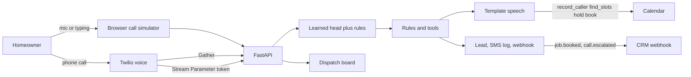

Two brains share one calendar. The caller never hears a fact the server did not render. With no API key the hazard screen is a logistic head on multilingual-e5-large. The head is embedded on every non-empty caller turn. A hand list can raise a level. It cannot skip the embedding. A positive routine clearance, including a battery chirp, a seasonal dust smell, comfort loss without a vulnerable person, a booking slot, and a name by itself, blocks a head page. An instruction that only names an emergency class does not page. Claude, when a key is set, can only raise a turn. It does not speak and does not book, cancel, or page.

**Rules.** The default, and the only brain when `ANTHROPIC_API_KEY` is empty. It owns the greeting, the questions, the offers, and the booking.

**Hazards.** Concept rules run first. Beside them, `sentence-transformers/paraphrase-multilingual-MiniLM-L12-v2` (fastembed 0.6.1, 384-d, mean pooling) scores the utterance against about 40 hazard prototypes and about 40 routine near-misses for gas, carbon monoxide, water, electrical, and unsafe indoor temperature. The trigram layer is gone. The weights are downloaded at image build into `FASTEMBED_CACHE_PATH` and are not committed. At runtime the loader uses `local_files_only=True` when those weights are already on disk, or when `HF_HUB_OFFLINE=1`. A failed load is remembered and not retried. A definite needs both a cosine and a margin over the routine prototypes. Beside the embedder, `MoritzLaurer/deberta-v3-xsmall-zeroshot-v1.1-all-33` runs offline on ONNX Runtime. It only upgrades a turn the keyword screen already marked as a safety question. It does not run on a turn the keywords cleared, and it does not turn a routine clearance into a page. It is English-biased: Spanish, Chinese, Arabic, French, and German stay on the keyword and MiniLM path. The weights are downloaded into `FASTEMBED_CACHE_PATH/nli` at image build and are not committed. On this CPU a short turn scores in about 37 ms after warmup. If those weights are missing, `/api/health` is 503 with `nli_ready: false`. The sample day is pre-baked, so seeding still runs. Uncontrolled water, steam, or scalding pages. A scorched or blackened outlet, and a buzzing or flashing panel, page. A dead outlet, an outlet-cover color, and a panel-replacement quote do not. A finished repair stays a routine call. A smell, a leak, or another hazard in the same breath still pages. "Just asking" and "how fast in an emergency" do not page. Water moving from a ceiling or an appliance, sewage coming back through a drain, a detector that is shrieking or showing a high number, and a scorched or too-hot surface page even when the caller never uses the textbook word. An explicit "no sparks" or a green "just test it" light does not page. A damp spot, a faint odor, or a slightly warm outlet asks "Is anyone in danger or is there gas, smoke, sparks or water near electricity right now?" instead of booking or paging. No heat or no cooling is urgent together with an older adult, an infant, oxygen, or an extreme indoor temperature, including a bare number after "it's" or "inside". A bare "the AC is not cooling" stays a routine booking. Fee questions, an emergency fund, stove conversions, and a car out of gas do not page. If the embedder cannot load, an uncertain turn asks that safety question instead of returning "no hazard," and `/api/health` returns 503 with `semantic_ready: false` and `degraded` listing `semantic`. Gas or carbon monoxide advice stops at leaving the house and calling 911 or the gas company. A no-heat emergency tells the caller to keep a vulnerable person warm or cool and to call 911 if someone is unwell. There is no DIY relight or battery-swap instruction.

**Rules plus a learned head on every caller turn.** The logistic head on `intfloat/multilingual-e5-large` is the base screen. It runs before slot filling, including the name, the phone, and a quote, so a gas smell given in answer to "what's your name?" pages and is not stored as a name. No hazard-word list is consulted before that embedding. Hand rules, the MiniLM prototypes, and DeBERTa NLI can raise that level. A head page is dropped when the rules already recognize a routine clearance, a slot, a bare name, or an instruction that does not also describe a present hazard. If the e5 checkpoint is missing, a turn the rules do not already understand asks the safety question (`Hazard model unavailable`) instead of the generic menu. With no API key the classifier is `e5-head` when the head weights and e5 are loaded, `keyword+nli` when the head is missing but MiniLM and DeBERTa are loaded, or `keyword` when a model is missing. The desk is in Demo mode: the replies are the shop rules, and the board says so. `start.sh` and compose do not load a local instruct model, and `UNDERSTAND_EACH_TURN` does not turn one on. The gather path does not say "One moment." The Claude path and the OpenAI path are not measured here, because this checkout has no key.

**Your own key.** The simulator has a session-key setting. Paste an Anthropic key or an OpenAI key. The provider is detected from the prefix (`sk-ant-` is Anthropic, another `sk-` key is OpenAI) or you can choose it. The browser holds that key in memory for the tab. It is not written to localStorage, the database, or the logs. Your key is used only for this session and is never stored or logged. We recommend rotating or revoking the key after testing. `ANTHROPIC_API_KEY` and `OPENAI_API_KEY` also work for a self-hosted process. Defaults are `claude-sonnet-5-5` and `gpt-4.1` (`ANTHROPIC_MODEL` and `OPENAI_MODEL` override them). The safety rules run first in both modes. A key can raise a call to a page or choose a tool. It cannot lower a page or a safety yes. A refused key, or one with no quota, falls back to the demo reply and the screen says so. The badge reads "Demo mode: sample responses. Add your API key for live AI." until a key is accepted, then "Live AI (Claude)" or "Live AI (OpenAI)". Demo replies are not described as Claude or GPT.

When `ANTHROPIC_API_KEY` is set, Claude `claude-sonnet-5-5` (`ANTHROPIC_MODEL` overrides the id) may add one JSON label: `intent`, `hazard` (`none`, `possible`, or `present`), `hazard_class`, `temporal` (`current`, `past`, or `hypothetical`), `danger_answer`, plus `name`, `address`, and `date_phrase`. Pydantic checks it and drops extra keys. That call times out at 1.5 seconds. It can raise a keyword `none` or `ask` to a page or a safety question when it says `hazard=present` with `temporal=current`, the turn is not a plain job and not entirely past or hypothetical, and the caller's words support that class (a gas label needs gas, sulfur, or rotten eggs). It cannot lower a keyword page. A missing or timed-out call leaves the keyword decision as it stands. Name, phone, address, ZIP, offer, confirm, and cancel-confirm turns do not call Claude. Live Claude was not called for the scores below.

A yes to the safety question always pages, including when the caller adds that they stepped outside, left the house, or evacuated. "Yes", "yeah", "yep", and "yup" are that yes. Leaving the building without a natural no also pages. Claude cannot turn that page into a booking. A natural no still clears: "nope", "not at all", "nothing like that", "we're fine", "we're okay", "everyone's okay", "nobody is in danger", "not that I can tell", and "all clear", even with "it can wait" or "I just want it looked at". Harm, a hedge, "I don't know", hurry, or a definite hazard in the rest of the turn still pages.

The keyword screen reads the whole turn, including a later clause. A rate question or a bath-fan quote in the first sentence does not hide smoke or water at the end. Water pressing on a ceiling, or a ceiling that is bulging, ballooning, sagging, or swollen with water, pages. A shock or a tingle from a faucet, fixture, appliance, switch, outlet, or railing pages. Smoke that is not a cooking smell and not a smoke-alarm mention pages. A past clause ("last winter the disposal threw sparks") or a hypothetical ("if the ceiling ever sagged", "what would the fee be if we ever needed a gas-line repair") does not page that clause. A seasonal dusty or burning-dust smell on the first cold day, a fee or rate comparison, a household emergency plan, and a practice fire drill do not page. A negated leak, including "leak nahi" or "leak nahin" after the hazard word, does not page.

A lexicon covers gas, smoke, fire, shock, flooding, and carbon-monoxide symptoms in Spanish, beside Polish, Urdu, and Hindi, and the existing French, German, and Chinese keyword path. Spanish routine calls book in the normal intake. Other scripts (Devanagari, Arabic, Cyrillic, CJK) are not booked. If that turn has no hazard, Riley offers a callback and does not close it as a finished qualification. A definite hazard still transfers.

Before the rules run, the turn is folded: lowercase, accents removed, a short list of non-words repaired (`smel`, `hous`, and a lone texting `r`), and Spanish hazard words glossed in place so the same composer sees them. Real words such as hose and small are left alone. The composer then pages from parts: water with a fixture, light, or flicker; steam or boiling with a person nearly hurt; a burning smell with a panel or outlet; a gas smell with dizziness, sleepiness, sickness, or watering eyes; a carbon-monoxide alarm with any of those symptoms, including when the caller is unsure. A water heater that is popping or rumbling, a pilot that will not stay lit, water at the base of a toilet, or an occasional odd smell asks the safety question before anyone is booked. A caller who already says there is no leak, and a seasonal dusty heat smell, stay routine. Insurance and inspection framing that mentions a burst does not page unless water is leaving now. A price question that asks to fix a burst still pages. Water sitting inside a dishwasher, washer, or fridge stays routine. A steam-shower valve, a CO or smoke-detector install, a boiler check, a buzzing bath fan, recessed lights, and a smoke-alarm replacement book.

A sump pump, exhaust fan, spigot, GFCI, flood-sensor install, inspection, checkup, or yearly heat-pump service books without the danger question. "Treat this as a fire emergency" does not page unless the caller also describes a real hazard. On the name, phone, address, and ZIP turns, a sentence that tells the desk to ignore instructions, treat the call as an emergency, or page on-call is dropped, and the booking continues with the name or street that remains. A name is taken from the name question or from "my name is", "me llamo", "this is", or "I'm", and Unicode letters are accepted. It is not taken from the problem sentence, a phone number, a ZIP, a street, markup, braces, a percent template, or a code-like token. A bad name is not saved as a sanitized remnant. A second answer that still is not a name hands the call to the office on every path, including the same bad name twice. Punctuation with no letters is stored as Caller so the question stops. A key-shaped string in a caller line is stored as `[redacted]`. An open call with no outcome for 20 minutes is closed as missed, so an abandoned simulator session does not stay "In call".

`/api/health` reports `classifier` (`e5-head` when the learned head and multilingual-e5-large are loaded and no API key is set, `keyword+nli` when the head is missing but MiniLM and DeBERTa are loaded, `keyword` when a hazard model is missing, or `claude` when `ANTHROPIC_API_KEY` is set), `hazard_screen` (`head+rules+minilm+nli` when the head and both models loaded), `understander` (`off` when no API key is set, or the Claude model id), `understand_ready` (true only when `ANTHROPIC_API_KEY` is set), `semantic_ready`, `nli_ready`, and `degraded` (the names of any missing hazard model). `voice_ready` is true only when `TWILIO_AUTH_TOKEN`, `DEEPGRAM_API_KEY`, and `ELEVENLABS_API_KEY` are all set. Demo mode without those keys reports `voice_ready: false` and says it is not a live phone. `ok` is true when the e5 head, MiniLM, and the zero-shot model all loaded. A model file on disk, including a corrupt instruct file, is not reported as running. If the head, semantic, or NLI weights are missing, health is 503 and `degraded` lists `head`, `semantic`, or `nli`. A missing head fails closed to the safety question. The sample calls are still inserted. The process still starts. A gas smell still pages, and an ordinary drain call is not paged after the address.

A gas smell pages, including a hedge, when the word gas sits next to a smell or odor. "Possibly a gas smell, or maybe it is just the trash" pages. A sulfur or rotten-egg smell next to a stove, oven, furnace, dryer, meter, or pilot also pages, without the word gas. "What would a gas leak cost to repair if we ever had one?" does not page. "The gas leak was repaired and there is no odor today" does not page. "They repaired a leak last month, but I smell gas right now" does page. "Please hook up a gas dryer. There is no odor at all" books. A closet smell that is not gas, eggs, sulfur, or smoke asks the safety question. "No gas smell, just a slow drain" does not page.

**Languages.** Spanish routine calls book. A Spanish hazard still transfers. Portuguese, Tagalog, Hindi, Urdu, Arabic, and romanized Hindi or Urdu ask the safety question in that language, then offer a callback in that language. The Portuguese path is covered by `test_round14.py`. A definite hazard in those languages still transfers.

**Claude tools.** When a key is set, Riley is `claude-sonnet-5-5` (Anthropic’s current Sonnet, checked against [the models overview](https://platform.claude.com/docs/en/models/overview) on 2026-10-22). The model returns a tool call, not a caller-facing paragraph. `speak` takes an intent from a fixed set (`greet`, `ask_field`, `offer_slots`, `confirm_booking`, `quote_standard_prices`, `transfer`, `cancel_flow`, `goodbye`, `small_talk`) and an `empathy_id` from ten pre-written lines. A free-text empathy field is ignored. Unknown ids are dropped. No model-written string reaches the caller. `record_caller` stores a name, phone, or address only when that value is in the caller's own turns, then reads it back and asks the next question. `hold_slot` sticks only when the caller picks that window. `book` runs only when the caller's latest words are a clear yes to the server's read-back of that exact slot from a previous turn. "No" and "let me check with my wife" do not book. `transfer` runs only after the hazard classifier or the caller asked for a person. `follow_rules` is not a tool and is not a score.

Each model call is capped at 5 seconds. The whole turn gives up at 8 seconds or after two tool rounds, then the rules engine speaks. That stays inside Twilio's 15 second webhook limit.

**Live Claude has not been measured.** Pytest never calls Anthropic. `python -m evals.live_claude` is the opt-in probe. With no key it exits 2 and reports nothing. The numbers below are the local detector and the scripted tool tests.

Without voice keys, Twilio uses its own speech recognition and a spoken reply (`<Gather>` / `<Say>`). Three silent results hang up and ask the caller to call back. Emergencies return `<Dial>` with a 20-second timeout. If a second on-call number is set in the YAML, a no-answer tries that number once. If nobody answers, Riley gives guidance for the hazard on the call: leave and call 911 or the gas company, get everyone into fresh air for carbon monoxide, shut the main valve if it is safe for water, stay back and call 911 if there is smoke or fire for electrical, or keep a vulnerable person warm or cool and call 911 if they are unwell when the hazard is heat or cold. The missed transfer is saved as a lead with status `missed_transfer` and a `call.transfer_missed` webhook, and it sits at the top of the board with a red badge. In demo mode Riley says the office will call back when the on-call text was sent or the webhook was accepted, including a mock delivery, because the board is showing the alert. With `DEMO_MODE=0`, a mock webhook is not a promise: Riley says the call was logged for the office and to call 911 if anyone is in danger, unless SMS was sent or the webhook status is `delivered`. If Twilio SMS did not accept the page, Riley says no text was sent. Riley does not tell the caller to dial this shop number again. Gather is the path that actually dials. Media Streams turn on only when `DEEPGRAM_API_KEY`, `ELEVENLABS_API_KEY`, `TWILIO_ACCOUNT_SID`, and `TWILIO_AUTH_TOKEN` are all set. Without the account SID there is no way to speak a fallback, so the call stays on Gather. The stream URL has no token. TwiML passes a one-time HMAC in `<Parameter name="token">`, and the socket reads it from the start message `customParameters`. A replay is rejected. `DEMO_MODE=0` rejects a start message with no token. A speech or TTS error updates the live call with `<Say>` and `<Redirect>` back to Gather so intake continues. If that turn is already an emergency, the update is `<Dial>`, not `<Hangup>`. The stream flushes a turn on trailing silence. Until those keys exist, Gather remains the answering path.

**Twilio signature checks are disabled when `TWILIO_AUTH_TOKEN` is empty.** Startup logs that warning in those words. Demo mode then accepts unsigned local requests so the browser simulator works. Do not point a public Twilio number at that process. `DEMO_MODE=0` will not start a call without the token: voice webhooks and the media-stream socket return 503, `/api/health` sets `voice_ready` false and explains why, and an empty token does not make an unsigned webhook valid. The process itself stays up so the board can still sign in.

`/api/health` reports `classifier`, `hazard_screen`, `understander`, `understand_ready`, `semantic_ready`, `nli_ready`, `voice_ready`, and `degraded`. `ok` is true when the e5 head, MiniLM, and the zero-shot model all loaded. It does not require an instruct file. A missing head is listed in `degraded` and the desk asks the safety question. With those weights baked into the image and `HF_HUB_OFFLINE=1`, compose is healthy with no network and no API key. If a required hazard model is missing, the process still starts, the pre-baked sample day is still inserted, and `/api/health` returns 503. That is true with the default `SEED_ON_START=1`. In that degraded mode a gas smell still pages, and an ordinary drain call is not paged after the address.

## What was measured

`python -m evals.fresh` scores a frozen set of 112 sentences written for this desk before the margin was tuned. It is the local detector, not Claude, and not a reviewer's caller list. The private caller list was not copied and was not re-run.

The first score, before tuning the margin, the concept picker, or the prototypes:

| | Before tuning |
| --- | ---: |
| Frozen lines | 112 |
| Emergency recall | 34 / 36 |
| CO-battery advice | 6 / 8 |
| Routine lines kept routine | 67 / 68 |
| Routine false escalations | 1 / 68 |

Those five misses were a Chinese gas-odor line, a German flooded-basement line (the fold step had stripped the umlaut before the embedder), two carbon-monoxide battery lines the embedder raised from advice to ask, and "I only have an emergency fund question, not a leak," which the rules treated as an emergency. None of those sentences were deleted.

After that, the embedder keeps the original text, the closest concept wins rather than the widest margin, a battery chirp is not upgraded, "emergency fund" is not a page, and a few Chinese gas prototypes were added. They are not the frozen sentence. Second score:

| | After tuning |
| --- | ---: |
| Frozen lines | 112 |
| Emergency recall | 36 / 36 |
| CO-battery advice | 8 / 8 |
| Routine lines kept routine | 68 / 68 |
| Routine false escalations | 0 / 68 |

That second score is this desk's own set. It is not a claim about any private caller list.

`python -m evals.heldout` scores `evals/heldout_set.py`. It was written before the round-5 rules. The rules were then changed while looking at its misses, so the second table is a development score, not a held-out score. The only held-out figure for this file is the first table. The sentences were not edited.

| | Held-out, before the round-5 rules |
| --- | ---: |
| Lines | 97 |
| Emergency recall | 28 / 48 |
| Safety-question lines | 1 / 8 |
| CO-battery advice | 4 / 5 |
| Routine lines kept routine | 31 / 36 |
| Routine false pages | 3 / 36 |

| | Development set, after those rules |
| --- | ---: |
| Lines | 97 |
| Emergency recall | 48 / 48 |
| Safety-question lines | 7 / 8 |
| CO-battery advice | 5 / 5 |
| Routine lines kept routine | 36 / 36 |
| Routine false pages | 0 / 36 |

The safety-question miss on that development file is "Possibly a gas smell, or maybe it is just the trash." A test locks the behavior that a gas smell pages, including when the caller hedges. One unit test covers one after-hours rate sentence. That test does not prove that rate questions in general stay off the on-call line.

`python -m evals.unseen` scores `evals/unseen_set.py`, 58 lines written and scored before the round-6 class rules, then left unchanged. The first score is the held-out number. The second score is the same file after the rules. It is not an external review.

| | Held-out, before the round-6 rules |
| --- | ---: |
| Lines | 58 |
| Emergency recall | 17 / 36 |
| Safety-question lines | 2 / 3 |
| CO-battery advice | 1 / 1 |
| Routine lines kept routine | 17 / 18 |
| Routine false pages | 1 / 18 |

| | Same file, after the round-6 rules |
| --- | ---: |
| Lines | 58 |
| Emergency recall | 36 / 36 |
| Safety-question lines | 3 / 3 |
| CO-battery advice | 1 / 1 |
| Routine lines kept routine | 18 / 18 |
| Routine false pages | 0 / 18 |

An external review of an earlier build measured about two-thirds strict recall on its own unseen English paraphrases. A sealed review after that measured about 74% strict recall. This repo does not re-run those lists. 36/36 above is not either number.

`python -m evals.round7` scores `evals/round7_set.py`, 59 lines written and scored before the round-7 changes, then left unchanged. The first score is the held-out number. The second score is the same file after the rules and the zero-shot model. It is not an external review, and it is not a sealed caller list.

| | Held-out, before the round-7 changes |
| --- | ---: |
| Lines | 59 |
| Emergency recall | 18 / 35 |
| Safety-question lines | 4 / 4 |
| Routine lines kept routine | 17 / 20 |
| Routine false pages | 1 / 20 |

| | Same file, after the round-7 changes |
| --- | ---: |
| Lines | 59 |
| Emergency recall | 35 / 35 |
| Safety-question lines | 4 / 4 |
| Routine lines kept routine | 20 / 20 |
| Routine false pages | 0 / 20 |

A date past the booking horizon is named and is not booked as today. A missing hazard model returns 503 with `semantic_ready` false, and a missing zero-shot model returns 503 with `nli_ready` false, while `SEED_ON_START` stays on. The private caller list was not copied and was not re-run. Live Claude was not called.

`python -m evals.round8` scores `evals/round8_set.py`, 64 lines written and scored before the round-8 changes, then left unchanged. The first score is the held-out number for this file. The second score is the same file after the clause rules and the natural-no policy. It is not an external review, and it is not the sealed caller list from that review.

| | Held-out, before the round-8 changes |
| --- | ---: |
| Lines | 64 |
| Emergency recall | 15 / 36 |
| Safety-question lines | 1 / 6 |
| Routine lines kept routine | 19 / 22 |
| Routine false pages | 2 / 22 |
| Natural-no clears | 0 / 27 |
| Harm still pages | 10 / 10 |

| | Same file, after the round-8 changes |
| --- | ---: |
| Lines | 64 |
| Emergency recall | 36 / 36 |
| Safety-question lines | 6 / 6 |
| Routine lines kept routine | 22 / 22 |
| Routine false pages | 0 / 22 |
| Natural-no clears | 27 / 27 |
| Harm still pages | 10 / 10 |

36/36 is this file. It is not the sealed set from the review of `584496e`, which scored 5.0. On that reviewer's fresh set, first-turn recall was 19/35, false pages were 9/22, and bookings were 10/13. A later sealed review of `ab984aa` scored 5.5: first-turn recall 24/35 on both the local model and the keyword screen, false pages 6/22 and 5/22, bookings 12/13. Earlier sealed reviews measured about two-thirds and about 74% strict recall. This repo does not re-run those lists, and it does not claim those numbers moved.

`python -m evals.round9` scores `evals/round9_set.py`, 39 lines plus 21 safety answers, written and hashed before the round-9 keyword changes, then left unchanged. The hash is the sha256 of the labeled lines, not the docstring: `dc04696d30d4b3a32aa7647af126b05c77f602fd0500aa67693de250c3072934`. The first score is this file before those rules. The second score is the same file after them. It is the dev-set number. It is not the sealed review of `ab984aa`.

| | This file, before the round-9 rules |
| --- | ---: |
| Lines | 39 |
| Emergency recall | 11 / 25 |
| Routine lines kept routine | 12 / 14 |
| Routine false pages | 2 / 14 |
| Safety clears | 4 / 6 |
| Safety pages | 15 / 15 |

| | Same file, after the round-9 rules |
| --- | ---: |
| Lines | 39 |
| Emergency recall | 25 / 25 |
| Routine lines kept routine | 14 / 14 |
| Routine false pages | 0 / 14 |
| Safety clears | 6 / 6 |
| Safety pages | 15 / 15 |

That after score is the keyword screen only. Live Claude was not called, so there is no Claude column. The local 1.5B model is not on this path.

Live Claude was not called. There is no live tool-mode column. `follow_rules` is not in `TOOL_SPECS`.

`backend/tests/heldout_callers.py` is the copied v1 review set plus paraphrases from an earlier round (72 scripted cases). The rules engine still passes it. That file is not a generalization score, and it is not scored as tool mode.

Scripted guard tests, still without a live model, drop free-form text (a made-up afternoon, a made-up price, a discount, a "booked" claim). A cooperative script books only across two turns: the caller states the name, phone, and address and picks a window, then says yes to the read-back. An invented name or phone is not stored. "No" and a hedge do not book. An invented slot does not. A model-initiated `transfer` or `classify_hazard` on a faucet quote does not page. Cancel verification is stored on the booking. Three failures lock that booking, text the number on it when SMS is actually sent, and do not page on-call or read the emergency script. A later call with the right day is still refused. Separate tests cover accented names, Suite versus Apt, "ends in" and "at the end" phone corrections, a house-number correction read back at the offer, "ten-thirty," "the Tuesday after next," "afternoon except Friday," a date past the horizon, "first Monday in November," Halloween morning, "next week except Monday," and "half past" / "4ish."

Pytest: 322 passed, 4 warnings. None of them call Anthropic or OpenAI. The keyless path does not load a local instruct model. A visitor key in those tests is a fake header, and the test checks it never lands in the log, the database, or a transcript. `test_round9.py` accepts `classifier` `e5-head` when the learned head is loaded, `keyword+nli` when MiniLM and DeBERTa are both loaded and the head is not, and `keyword` when those weights are absent. The health test skips with a fetch-models message when those weights are missing.

A sealed review of `7f797cb` scored 6.5/10. It measured emergency recall 21/25 strict (23/25 if a safety question counts), first-turn false pages 0/20, multi-turn false pages 1/8, ambiguous lines 5/5, booking 7/8, injection obeyed 0/6 with the name slot corrupted, BYOK leaks 0, health latency p50 0.8 ms / p95 1.3 ms, and turn latency p50 4.3 ms / p95 17.6 ms. Pytest on that commit was 205/205 after `scripts/fetch_models.py`, and 202/205 without the NLI weights. This repo does not re-run that sealed list. `backend/tests/test_round10.py` covers the same classes with different lines. It is not that sealed set.

A sealed review of `e129ea9` scored 7.0/10. It measured emergency recall 21/26 strict (24/26 if a safety question counts), false pages 2, ambiguous lines handled 2/6, booking 6/8, saved names 6/6, garbage names 6/7, BYOK leaks 0, health latency p50 0.6 ms / p95 1.3 ms, and turn latency p50 5.0 ms / p95 20.9 ms. Pytest on that commit was 212/212 with the models and 209 pass / 1 fail / 2 skip without the NLI weights. This repo does not re-run that sealed list. `backend/tests/test_round11.py` covers the same classes with different lines.

`python -m evals.round11` scores 22 desk lines written after the composer (`evals/round11_set.py`, sha256 `3536e496b95c289a7265aa5ae4a25875cf8a95a55a0f78dfa295c82e5399e6bf`). It is not the sealed review. On this machine, with MiniLM and DeBERTa loaded: transfer 8/8, ask 4/4, routine 10/10, routine false pages 0/10.

A sealed review of `b2f76b6` scored 6.5/10, down from 7.0. It measured first-turn emergency recall 21/28, within two turns 22/28, late-turn hazards 1/5, false pages 1/24, routine lines sent to the menu 5/24, booking 6/8, and bad names 6/7. Pytest on that commit was 219/219 with the models. This repo does not re-run that sealed list, and this commit does not claim those numbers moved.

The learned head is a logistic regression on `intfloat/multilingual-e5-large` (1024-d). `scripts/train_hazard_head.py` (seed 20261023) builds a synthetic paraphrase set across English, Spanish, Portuguese, Tagalog, romanized Urdu/Hindi, Hindi, Urdu, and Arabic, then drops any line that also appears in a frozen eval or in `evals/round13_heldout_set.py`. The threshold was chosen on a validation split of that generator for emergency recall at least 0.95 and a false-page rate at most 0.02. This run: validation emergency recall 0.985 (512/520) and false-page rate 0.014. The shipped thresholds are page 0.55, ask 0.55, margin 0.02, routine lock 0.40, so the head's own middle band is narrow. The product middle band is the rules floor: a hazard noun plus a present-tense or symptom cue asks the yes/no safety question; only a high head score or a composition pages; a cleared routine proceeds.

Head-only numbers below are the head before rules, on `evals/round13_heldout_set.py` (148 lines written before this training, sha256 `85f1015ac4f77a31638016a40de7360591e4c4feb6be50f16bd558e2b49549e1`). They are not a sealed QA set. Emergency recall 0.921 (105/114). False pages 0 of 34 non-emergency lines. Ask recall 0/3. Routine recall 31/31. By family: gas 19/21 (0.905), carbon monoxide 17/18 (0.944), electrical 16/19 (0.842), flood 17/18 (0.944), water on electrical 10/10 (1.0), sewage 9/10 (0.9), comfort 17/18 (0.944). By language: English 29/30 (0.967), Spanish 11/12 (0.917), Portuguese 10/12 (0.833), Tagalog 12/12 (1.0), romanized Urdu/Hindi 9/12 (0.75), Hindi 12/12 (1.0), Urdu 11/12 (0.917), Arabic 11/12 (0.917). `evals/round13_metrics.json` is that file.

Rules plus the head, on the same 148 lines, after the head runs on every turn: `classify_emergency` pages 114/114 emergencies and 0 of 34 non-emergencies. The earlier 88/114 figure was measured while a hazard-word list still skipped the embedding. That list is gone. Composition still pages a short romanized gas odor, a burst pipe, sparks from a socket, an active monoxide alarm with a symptom, and no heat or no cooling with a vulnerable person and an extreme temperature. A gas-fireplace service that says there is no odor does not page. A few chirps with a low battery stay advice. `backend/tests/test_round13.py` covers those classes with lines that are not the held-out file.

`evals/round14_heldout_set.py` is a new 80-line set written before this round's threshold was left as shipped (sha256 `9d23e681d3238e381a1b8504a9fe94eb4324d3a4a4b0ad694f805f37b368aa96`). Thresholds stayed page 0.55, ask 0.55, margin 0.02, routine lock 0.40. Head-only emergency recall is 55/62 (0.887), with 2 head false pages on 18 non-emergencies (a roleplay line that only names a gas emergency, and the bare name Helena Costa). End to end, `classify_emergency` pages 60/62 emergencies and 0 of 18 non-emergencies. The two misses are a Portuguese spark line and an Arabic sewage line, both under the 0.55 page threshold at the head (0.527 and 0.540). By family, end to end: gas 10/10, carbon monoxide 9/9, comfort 9/9, flood 9/9, water on electrical 8/8, electrical 8/9, sewage 7/8. By language, end to end: English 13/13, Spanish 7/7, Tagalog 7/7, Hindi 7/7, romanized 7/7, Urdu 7/7, Portuguese 6/7, Arabic 6/7. The two head false pages do not transfer. `evals/round14_metrics.json` is that score.

`evals/round15_heldout_set.py` is a 47-line set written before this round's threshold was left as shipped (sha256 `5f4a0d1da2f0109ae11b2d01cb70e3b956cb7e133d923c30e32ef97ea9373884`). The page cut stayed at 0.55. It was not moved to catch the one head miss. Head-only emergency recall is 25/26 (0.962), with 2 head false pages on 21 non-emergencies: the Spanish booking time "el martes por la mañana" (p 0.661) and the vague English line "I am not sure how to describe the situation." (p 0.643). End to end, `classify_emergency` pages 26/26 emergencies and 0 of 21 non-emergencies. The head miss is a romanized gas line at p 0.506, under the page cut; composition still pages it. By family, end to end: gas 3/3, carbon monoxide 1/1, comfort 5/5, flood 3/3, water on electrical 4/4, electrical 9/9, sewage 1/1. By language, end to end: English 10/10, Spanish 3/3, Portuguese 2/2, Tagalog 3/3, romanized 3/3, Hindi 2/2, Urdu 1/1, Arabic 2/2. A present water-on-electrical or smoke clause is screened before catalogue keywords and slot parsing, so it is not booked as lighting and it is not treated as a missing street. A line under the page cut that is not a recognized routine asks the safety question in the detected language. Tagalog and romanized Urdu/Hindi are detected before English intake. Instruction sentences are stripped before the emergency-word rules. A negated "no danger" answer, in English, Spanish, Portuguese, Tagalog, romanized Urdu/Hindi, Hindi, Urdu, or Arabic, does not page. A temperature emergency uses the keep-warm script in the caller's language. `evals/round15_metrics.json` is that score.

`evals/round16_heldout_set.py` is a 47-line set written before this round's policy edit (sha256 `96450e399d310f0695ecddc1dc7d0785e8b4684b2cb2e428378d3e361cf66d93`). The cuts stayed page 0.55, ask 0.55, margin 0.02, routine lock 0.40. End to end, a fresh call pages 24/24 emergencies and 0 of 23 non-emergencies. Non-English hazards do not open the English menu: 13/13. Instruction and roleplay lines that only say "emergency" do not page: 0 false pages on 3 lines. A supply that has let go, a room that is filling, and a howling detector with illness stay present, including when the same sentence also says drip. A definite head at or above 0.80 is kept unless the turn is a recognized routine with no present hazard. The word emergency inside a booking or an instruction does not page on its own. A rotten-egg odor or dizziness is not downgraded to a question. A turn that names neither a job nor a hazard is not stored as the issue; after two such turns the safety question is asked, and a clean no offers a callback without asking for a phone number. Gas, water, sewage, electrical, and carbon monoxide each use their own one-line guidance, in the caller's language. Temperature still uses the keep-warm sentence. `evals/round16_metrics.json` is that score.

`evals/round17_heldout_set.py` is a 46-line set written before this round's policy edit (sha256 `38bb371951c67e73b4e9d2d4752fade8a70f5a249655b1da0d417eb3c9cae5fe`). The cuts stayed page 0.55, ask 0.55, margin 0.02, routine lock 0.40. A head at or above 0.80 is kept before hard-routine, catalogue, plain-job, or mild-drip clearance. Those clearances can zero that head only after the present-hazard check has confirmed a real routine with no present hazard. Sewage wording that is not the textbook noun counts in Spanish, Portuguese, Tagalog, romanized Urdu/Hindi, Hindi, Urdu, and Arabic. A unit that is howling or screaming together with illness counts without the words detector or alarm, and a drip in the same sentence does not turn that into a mild job. Portuguese household and comfort words are detected before English, and the transfer uses that language. A ceiling mark or a knocking boiler stays on the safety question. A vague-menu match can clear a head only under 0.80. End to end, a fresh call pages 24/24 emergencies and 0 of 22 non-emergencies. Non-English hazards do not open the English menu: 17/17. Booking and instruction lines that only say "emergency" do not page and do not quote the dispatch fee: 0/3. Of the lines whose head is at or above 0.80, 7/7 are escalated and 0 are left on intake. By family, end to end: sewage 10/10, carbon monoxide 3/3, gas 3/3, flood 2/2, water on electrical 1/1, electrical 3/3, comfort 2/2. `evals/round17_metrics.json` is that score.

`evals/round18_heldout_set.py` is a 45-line set written before this round's policy edit (sha256 `12a7ab82306727b43a91a27f50c2c6d7462427aee33cd0aac756af77ed0629ed`). The cuts stayed page 0.55, ask 0.55, margin 0.02, routine lock 0.40. A head at or above 0.80 stays until a positive routine match finds no hazard. A fixture word, a drip, or the word emergency is not that match, and that keep runs before the emergency-word branch. When the head is already at or above 0.80 and the match misses, the turn is paged or asked the safety question, and it is not stored as a faucet, a toilet, or a water heater. A yowling or wailing unit together with illness counts without the words detector or alarm, including when the same sentence has a drip. Everyday dirty-water sewage counts when the caller also says emergency or names the toilet. A denied gas-and-smoke list in Spanish or Portuguese stays routine, and a past failure the caller says is dry now stays routine. Neither quotes the dispatch fee. A circle or a stain on plaster, and a bang from a furnace or a boiler, stay on the safety question. A water heater that only bangs still books. Portuguese baby, cold-room, and heating words are detected before English, and the transfer uses the warm script in that language. Sewage uses the stay-away line, not the water-valve line. The second turn that names neither a job nor a hazard asks the safety question, and a clean no offers a callback without asking for a phone. End to end, a fresh call pages 21/21 emergencies and 0 of 24 non-emergencies. Non-English hazards do not open the English menu: 13/13. Booking and instruction lines that only say emergency do not page and do not quote the fee: 0/2. Heads at or above 0.80 with neither a page nor a safety question: 0 of 12. Howling plus illness pages 4/4. By family, end to end: sewage 9/9, carbon monoxide 4/4, gas 3/3, flood 1/1, electrical 2/2, comfort 2/2. `evals/round18_metrics.json` is that score.

`evals/round19_heldout_set.py` is a 46-line set written before this round's policy edit (sha256 `75af3b979693fe19f65339d083061a6816318ba4de8a705f4d59d9ba8d5bfbf9`). The cuts stayed page 0.55, ask 0.55, margin 0.02, routine lock 0.40. A benign-home word such as blower is not a positive routine, so it cannot zero a head at or above 0.80. A thump from a furnace or a boiler, and a ring or a blotch on plaster, stay on the safety question. A water heater that only bangs still books. A howling or yowling place plus illness still pages on the fresh-air line when the same sentence has a drip. Everyday sewage, including a Spanish "agua marrón" line and a Portuguese "água podre" line, uses the stay-away line. A "no hay … ni …" or "não tem … nem …" denial of gas and smoke stays routine, including when the second noun sits outside the five-word negation window. A past failure on a holiday that the caller says is still dry, or that dried out, stays routine. An instruction that only tells the desk to declare a fire does not page. None of those quote the dispatch fee. Portuguese is detected from a baby, a cold room, or heating even when those words sit outside the short hint list, and the page uses the warm script. After two failed parses of the issue, the next turn is an office callback. A street address on that turn is not stored as the issue and is not treated as a yes. End to end, a fresh call pages 22/22 emergencies and 0 of 24 non-emergencies. Three of those emergencies are under the 0.55 head cut and still page from the present-hazard rules: the Portuguese comfort lines at 0.488 and 0.471, and the dryer-plug sparks line at 0.542. The page cut was not moved. Non-English hazards do not open the English menu: 14/14. Booking and instruction lines that only say emergency or fire do not page and do not quote the fee: 0/3. Howling plus illness pages 4/4. By family, end to end: sewage 9/9, carbon monoxide 4/4, gas 3/3, flood 1/1, electrical 2/2, comfort 3/3. Heads at or above 0.80 with neither a page nor a safety question: 1 of 12. That line is the frozen ice-maker overflow into the freezer, head 0.8046, booked because the water stays in the freezer. It is a positive routine, not a missed hazard. The furnace-thump line on this set scores 0.638 and asks the safety question. A forced head of 0.81 on that same line asks or pages and does not collect a name. `evals/round19_metrics.json` is that score.

`evals/round20_heldout_set.py` is a 44-line set written before this round's policy edit (sha256 `bcc2bf02c58b73c5e501ff857217d1d74f417b5271d8010ac540530e6f8fe69e`). The cuts stayed page 0.55, ask 0.55, margin 0.02, routine lock 0.40. The keep now starts at that page cut. A definite head at or above 0.55 stays until a positive routine match finds no hazard. A drip, a fixture, a fan, a leak label, or the vague menu does not clear a howl plus illness, sewage, or water leaving an electrical surface. The unused benign-home clearance, including the word blower, and the unused confirmed-safe clearance are gone. A howl plus illness pages on the fresh-air line without the words detector or alarm. Illness includes queasy, lightheaded, short of breath, and a splitting head. The source includes a return, a grille, a vent, and a monitor. A drip in the same sentence does not store a faucet. Sewage in everyday words uses the stay-away line in the caller's language. Gas at a regulator uses the leave-the-house line. Water leaving a ceiling fan is electrical and uses stay-away. A baby or an older person in a cold room, with heat that has stopped and no degree number, uses the warm line, including in Portuguese. The discover menu follows the detected language. A street, a bare slot, or a booking phrase answered to the safety question is not a yes and does not quote the fee. End to end, a fresh call pages 24/24 emergencies and 0 of 20 non-emergencies. Four of those emergencies are under the 0.55 head cut and still page from the present-hazard rules: romanized sewage at 0.513, the English newborn line at 0.515, and the Portuguese comfort lines at 0.435 and 0.516. The page cut was not moved. Non-English hazards do not open the English menu: 12/12. Booking and instruction lines that only say emergency or declare a fire do not page and do not quote the fee: 0/2. Howling plus illness pages on the fresh-air line: 6/6. Sewage uses stay-away: 9/9. By family, end to end: carbon monoxide 6/6, electrical 3/3, sewage 9/9, gas 2/2, comfort 3/3, flood 1/1. Heads at or above the page cut with neither a page nor a safety question: 3. All three are positive routines, so the missed-hazard gap is 0. They are the powder-room aerator booking at head 0.628, the declare-fire instruction at 0.564 (classify asks, and the engine drops that instruction so the caller hears the menu), and the ice maker overflowing into the freezer at 0.805. A forced head of 0.72 on a vague driveway line asks the safety question and does not collect a name. The same forced head on a faucet booking does not page. Fresh set: transfer 36/36, advice 8/8, routine 68/68. `evals/round20_metrics.json` is that score.

`evals/round21_heldout_set.py` is a 45-line set written before this round's policy edit (sha256 `b89c9a8673a91c4d0fc28bc91689f2aab6e3ab920e3ff516a5da8b407fc8e559`). The cuts stayed page 0.55, ask 0.55, margin 0.02, routine lock 0.40. The source default for the page cut is 0.55, so a missing checkpoint does not reopen a 0.80 gate. A drip, a fixture, or a tub does not zero a definite head when the same turn still has a howl, an illness, an odor, sewage, sparks, or water leaving a ceiling fan. A faucet leak or a slow drain with nothing else still books. Sewage wording, including foul water, fetid water, and gray water, uses the stay-away line. A rotten-egg odor, including the hyphenated form and the Hindi, Urdu, and Arabic egg phrases, uses the leave-the-house line. Water leaving a ceiling fan stays electrical when a room name sits between the water and the fan. Spanish howl and spark words, and Portuguese howl and spark words, are detected before English. A weekday plus a meal answered to the safety question is not a yes and does not quote the fee. A basin that empties slowly is stored as a clogged drain even when the exact phrase "slow drain" is absent. End to end, a fresh call pages 26/26 emergencies and 0 of 19 non-emergencies. One emergency is under the 0.55 head cut and still pages from the rules: the Portuguese comfort line at 0.439. The page cut was not moved. Non-English hazards do not open the English menu: 15/15. Booking and instruction lines that only say emergency or pretend a fire do not page and do not quote the fee: 0/2. Howling plus illness uses the fresh-air line: 5/5. Sewage uses stay-away: 9/9. By family, end to end: carbon monoxide 5/5, electrical 4/4, sewage 9/9, gas 5/5, comfort 2/2, flood 1/1. Real-hazard heads at or above the page cut with neither a page nor a safety question: 0. Fresh set: transfer 36/36, advice 8/8, routine 68/68. `evals/round21_metrics.json` is that score.

fastembed 0.6.1 does not ship multilingual-e5-small. A logistic head on paraphrase-multilingual-MiniLM-L12-v2, trained on the same corpus, reached about 0.72 emergency recall on the round-13 file and about 0.14 on the romanized slice, so it was not shipped. e5-large stays. The e5-large ONNX blob on disk is 2,235,363,328 bytes (2.24 GB). The cache directory around it is 2,252,995,899 bytes. The round-21 demo, with MiniLM, e5-large, and DeBERTa loaded, is 2.51 GB RSS (2,626,876 KB), high-water 2.52 GB (2,640,564 KB), and peak 4.55 GB (4,767,360 KB) on this machine. `scripts/fetch_models.py` downloads e5-large in the same step as MiniLM and the NLI weights.

## Screenshots

The desk uses Geist, a white and zinc surface, and one safety-orange accent. Light and dark are both available. These shots are the Demo mode board: sample calls, a mocked CRM, and replies from the shop rules.

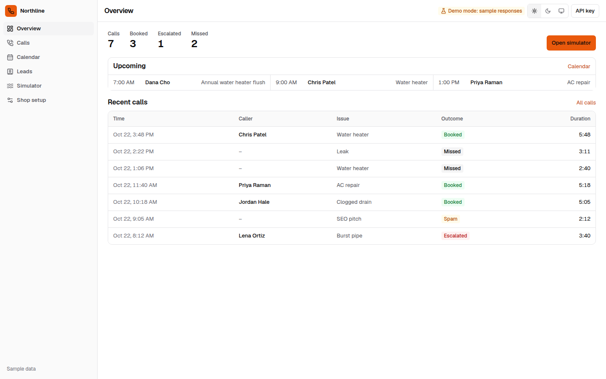

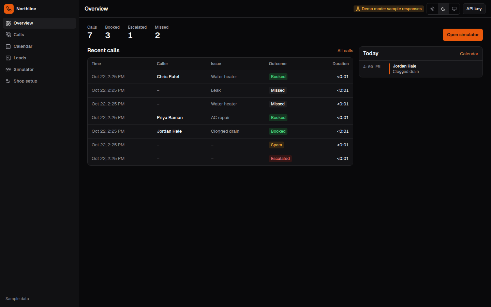

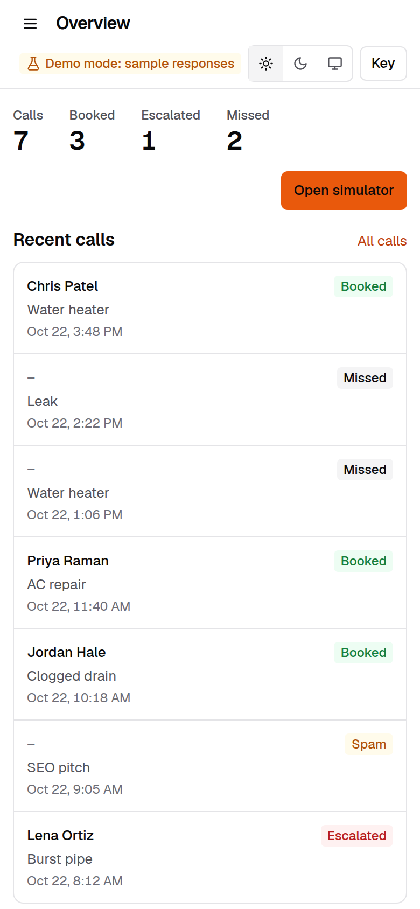

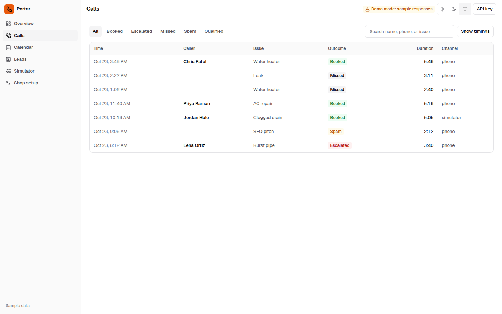

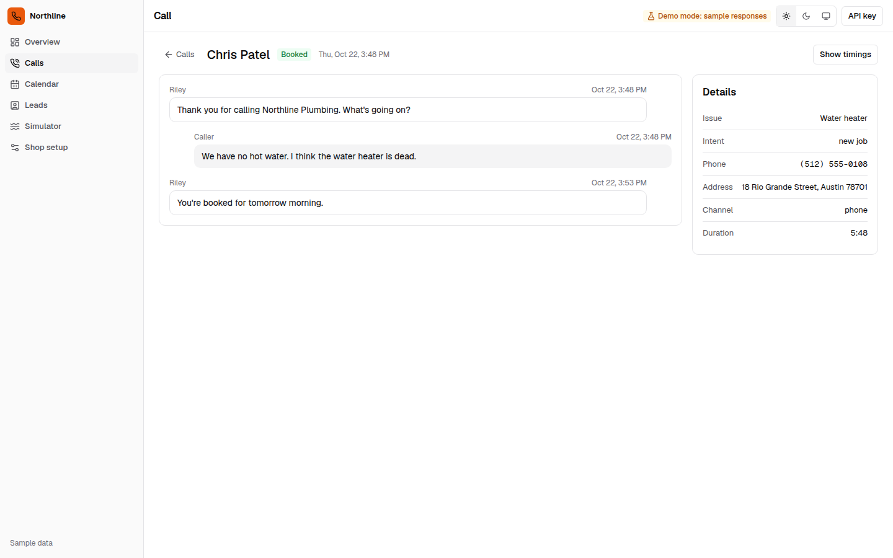

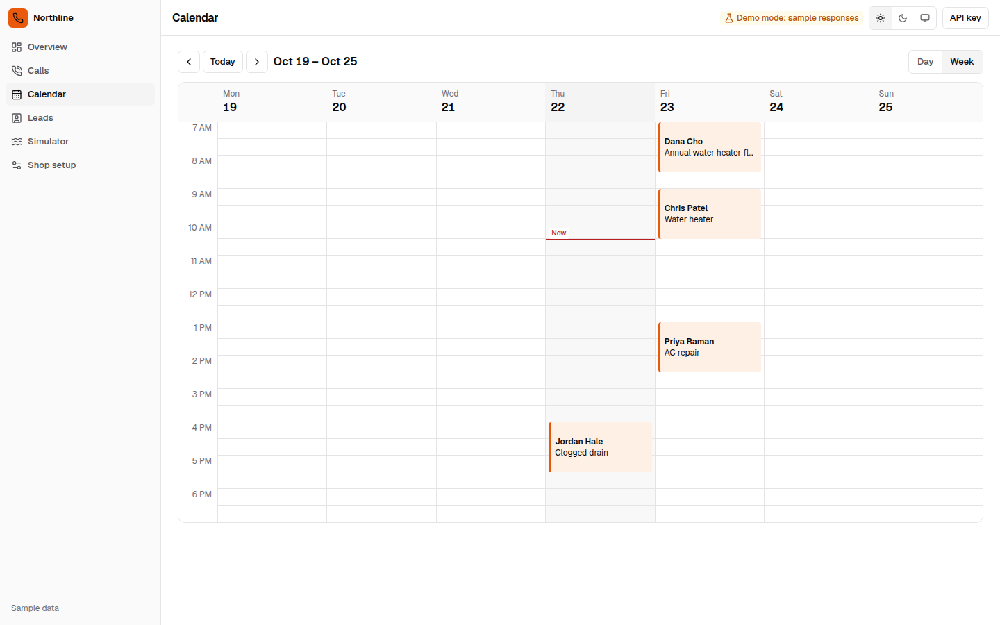

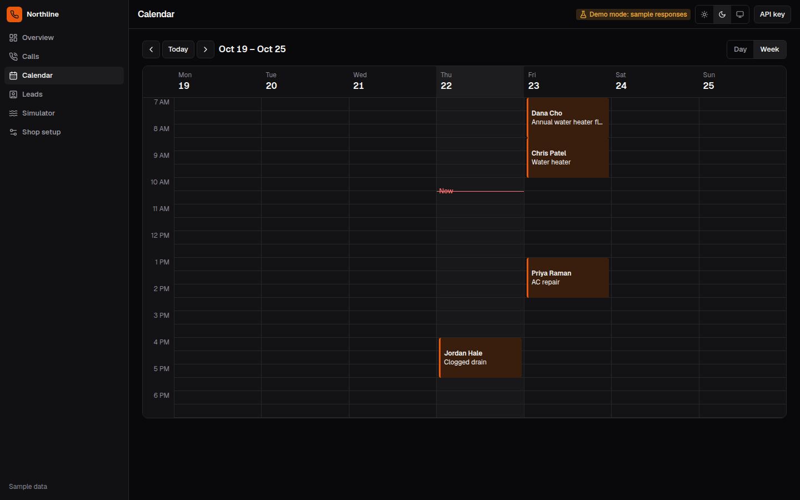

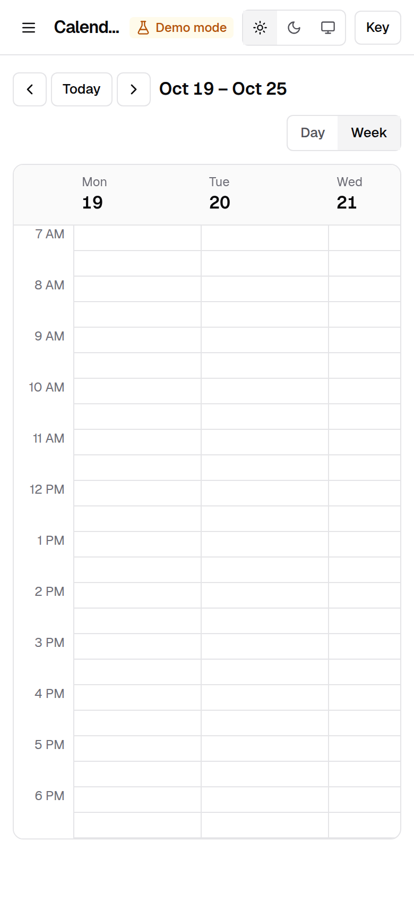

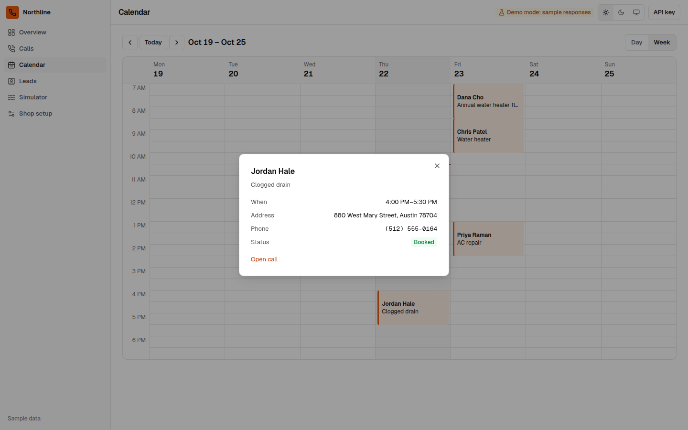

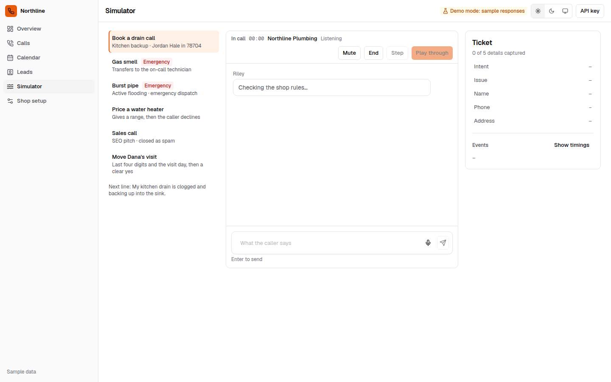

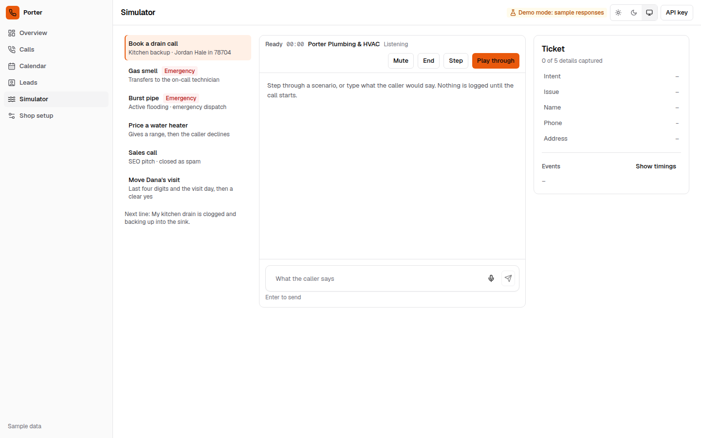

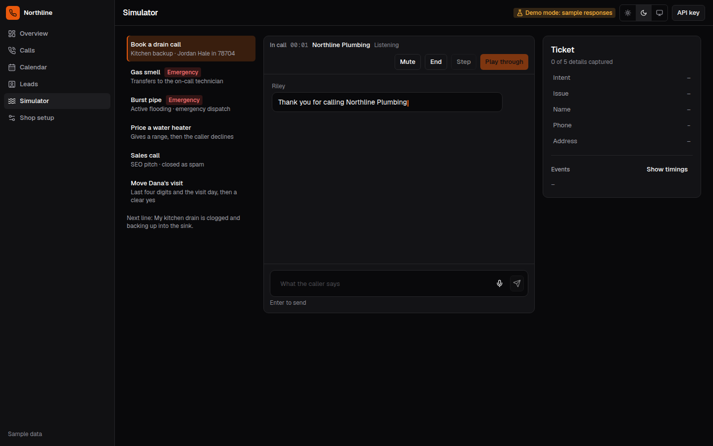

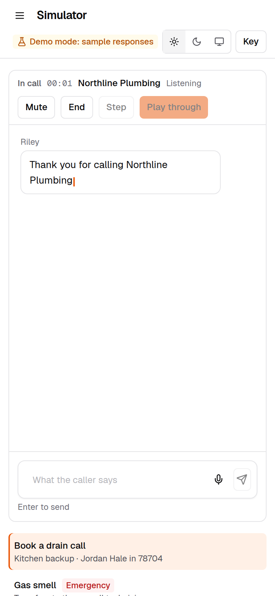

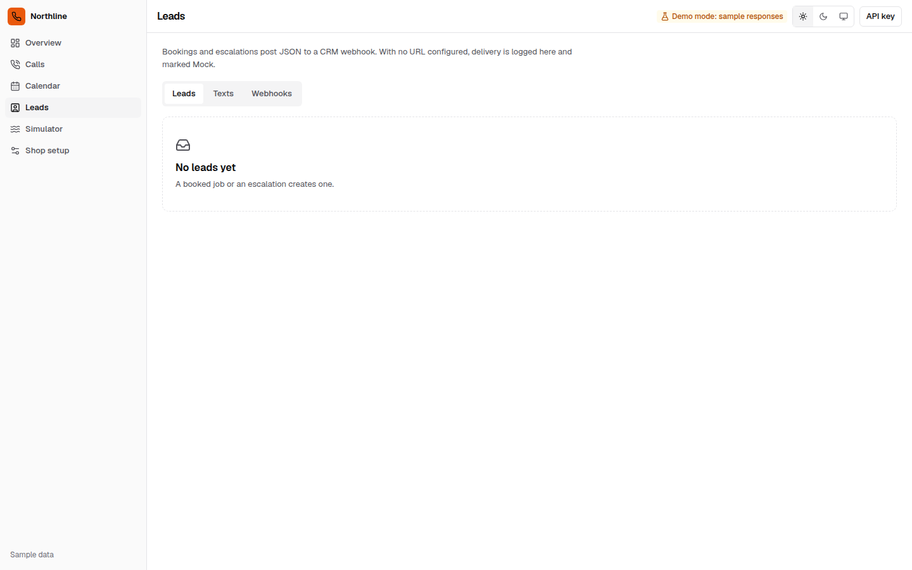

## Run it

Compose publishes `127.0.0.1:43123` and defaults to `DEMO_MODE=0`. Inside the container, uvicorn binds `0.0.0.0` so that published port can reach it. `ADMIN_TOKEN`, Twilio settings, `PUBLIC_BASE_URL`, and `ANTHROPIC_API_KEY` are passed through when they are set in the environment. The image copies `evals/`, installs pytest, and downloads MiniLM, multilingual-e5-large, and the zero-shot model into `/app/models` during the build, before `HF_HUB_OFFLINE=1`. It does not download an instruct model. The database is the named volume `receptionist_data`, not a bind mount of `./data`. An older compose file bind-mounted `./data`, and a root-owned `data/receptionist.db` left from that mount makes host pytest fail to open the database. Delete that file or `chown` it back to your user. The default host path is `data/receptionist.db` (`DATABASE_PATH`). With `DEMO_MODE=0` and an empty `TWILIO_AUTH_TOKEN`, the process still starts, logs that Twilio signature checks are disabled, and the board can sign in, but voice routes return 503 until the token is set. Demo mode is opt-in:

```bash
DEMO_MODE=1 docker compose up --build
```

Or without Docker. `start.sh` creates `.venv`, installs the app and pytest, runs `scripts/fetch_models.py` so a fresh clone downloads MiniLM, multilingual-e5-large, and the zero-shot model, builds the frontend, and binds `127.0.0.1:43123` with `DEMO_MODE=1`. An empty `TWILIO_AUTH_TOKEN` logs that signature checks are disabled. That is expected for the local demo and is not safe on a public number.

```bash
./start.sh
```

Open [http://127.0.0.1:43123](http://127.0.0.1:43123). The board is seeded with sample calls. The **Call simulator** is the live demo: step through “Book a drain call,” or play “Gas smell” to see the transfer.

Tests, with no API key:

```bash
python3 -m venv .venv
.venv/bin/pip install -r requirements.txt -r requirements-dev.txt
.venv/bin/python scripts/fetch_models.py
.venv/bin/python -m pytest
.venv/bin/python -m evals.fresh
```

`scripts/fetch_models.py` downloads MiniLM, multilingual-e5-large, and the DeBERTa NLI weights into `FASTEMBED_CACHE_PATH` (default `models/`). Run it before pytest. Without those weights `/api/health` is 503, and `test_health_reports_rule_brain` and `test_locked_api_requires_token_and_hides_demo` skip with the reason "MiniLM and DeBERTa NLI weights are not on disk. Run python scripts/fetch_models.py". The pre-baked sample day does not need the models.

`python -m evals.live_claude` exits 2 until `ANTHROPIC_API_KEY` is set. It is not part of pytest.

`requirements.txt` is the runtime image. Pytest lives in `requirements-dev.txt`. The image installs both and sets `PYTHONPATH=/app/backend:/app` so `pytest` can import the app and `evals`. Build once so the MiniLM weights are in the image, then run the suite with the network off. This Compose release does not accept `--network` on `compose run`, so the offline run uses the image directly:

```bash
docker compose build
docker run --rm --network none \
  -e HF_HUB_OFFLINE=1 \
  -e FASTEMBED_CACHE_PATH=/app/models \
  workspace-receptionist pytest -q
```

`docker compose up` stays on the default network so Twilio can reach the process later. It loads MiniLM and the zero-shot model from the baked weights (`HF_HUB_OFFLINE=1`). The healthcheck stays red until those two models are ready. It does not wait on an instruct file. Compose itself does not accept `--network` on `compose run`.

## Put it on a real phone number

1. Deploy the container on a host with a public HTTPS URL. The process listens on `0.0.0.0:43123`. Compose publishes `127.0.0.1:43123` on the host; change that binding when the host should accept traffic from Twilio.
2. Keep `DEMO_MODE=0` and set a long `ADMIN_TOKEN`. The board sends `Authorization: Bearer`. Demo reset stays closed. Twilio webhooks stay open so the carrier can post. The sign-in screen loads calls and leads. The simulator stays off unless demo mode is on.
3. Set `PUBLIC_BASE_URL` to that origin, including any path prefix. Signature checks use the full URL with the query string. The Media Stream URL does not carry the token. TwiML puts a single-use HMAC in `<Parameter name="token">`.
4. In Twilio, buy a number and set the voice webhook to `POST https://desk.example.com/api/voice/twilio/incoming`.
5. Set `TWILIO_AUTH_TOKEN`. With `DEMO_MODE=0`, voice routes refuse to start without it and an unsigned webhook is rejected. An empty token is not treated as valid. Demo mode is the only path that accepts unsigned local requests.
6. Set `TWILIO_ACCOUNT_SID` as well if Media Streams should update the live call with `<Dial>` when a transfer is required. Set `TWILIO_FROM_NUMBER` too if a real SMS should be sent. Without it, the desk logs the body and says no text was sent.
7. Optional: `ANTHROPIC_API_KEY` or `OPENAI_API_KEY`. Defaults are `claude-sonnet-5-5` and `gpt-4.1`. Override with `ANTHROPIC_MODEL` or `OPENAI_MODEL` only if you have confirmed the id. A visitor can also paste a key into the simulator for that browser tab. It is held in memory, never stored or logged. Rotate or revoke it after testing. Run `python -m evals.live_claude` yourself. This repo does not ship a live score. The Claude path and the OpenAI path are not measured without a key.
8. Optional: `DEEPGRAM_API_KEY` and `ELEVENLABS_API_KEY` for Media Streams. `voice.mode` in the YAML can force `gather` or `stream`. Stream mode stays on Gather until both keys exist.
9. Set `crm.webhook_url` in `config/business.yaml` to a CRM webhook. GoHighLevel, HubSpot, and Zapier all accept this JSON. Set `WEBHOOK_SECRET` to sign the body as `X-Receptionist-Signature`. Until a URL is set, payloads are logged on the Leads page with status `mock`.

A burst pipe or gas smell returns TwiML that dials `escalation.on_call_phone` after Riley tells the caller who is picking up, and quotes the $179 emergency dispatch fee. Optional `escalation.on_call_phone_2` is dialed once if the first number does not answer. If the dial fails, the caller hears guidance for that hazard (gas, carbon monoxide, water, or electrical) and that someone will call back. If SMS was sent, Riley also says the on-call tech is being paged. If SMS was not sent, Riley says no text was sent. A verification lockout never uses this script.

## Configuration

`config/business.yaml` is the shop. Edit the name, agent name, hours (`sunday: null` means closed), ZIP codes, price rules, and the on-call contact. Restart the process. The simulator, the tests, and the phone webhook all read that file.

Environment variables are listed in `.env.example`. None are required for the local demo. `start.sh` defaults `DEMO_MODE` to on. Docker defaults it to off. `CORS_ORIGINS` defaults to the local board, not `*`. Request bodies over 100 KB are rejected. Calls and leads are kept 30 days (`RETENTION_DAYS`), then purged on startup and once a day.

## Project layout

- `backend/app/agent` — hazard concepts, MiniLM margin scorer, offline zero-shot NLI, the JSON understander, template speech, calendar, rules engine, and the tool dialog
- `backend/app/llm` — Claude client and the scripted stand-in used in tests
- `backend/app/voice` — Twilio signature check, Gather, dial fallback, single-use stream token
- `backend/app/integrations.py` — Deepgram, ElevenLabs, Twilio SMS, and the signed CRM POST
- `backend/tests` — scenarios, the copied v1 review file, and guard tests
- `evals/fresh_set.py` — the frozen 112 lines written for this desk before tuning
- `evals/heldout_set.py` — 97 lines. 28/48 is the held-out score. 48/48 is the development score after the rules
- `evals/unseen_set.py` — 58 lines written before the round-6 rules. 17/36 was the held-out score
- `evals/round7_set.py` — 59 lines written before the round-7 changes. 18/35 was the held-out score. 35/35 is the same file after those changes
- `evals/round8_set.py` — 64 lines written before the round-8 changes. 15/36 was the held-out score. 36/36 is the same file after those changes
- `evals/round9_set.py` — 39 lines plus 21 safety answers, hashed before the round-9 rules. 11/25 was the before score. 25/25 is the same file after those rules. The hash is `dc04696d30d4b3a32aa7647af126b05c77f602fd0500aa67693de250c3072934`
- `scripts/fetch_models.py` — downloads MiniLM and the zero-shot model
- `evals/live_claude.py` — opt-in live probe
- `frontend` — dispatch board and call simulator
- `config/business.yaml` — the sample plumbing and HVAC shop

## Suggested portfolio line

**Title:** AI Receptionist that answers, qualifies, and books plumbing and HVAC calls

**Description:** Missed calls are lost jobs. This receptionist picks up for a plumbing and HVAC shop, qualifies the caller, and books a real window on the shop calendar. With no API key the hazard screen is a logistic head on multilingual-e5-large (`classifier: e5-head`). Hand rules can raise that level. A recognized routine clearance can block a head page. The optional understander is `off` until an API key is set. The screen runs on every caller turn before the name or phone is stored. Spanish routine calls book. Other languages get a hazard check and a callback. A confirmation text goes out only when Twilio SMS accepts it. It demos in the browser with no API keys. With an Anthropic key, Claude can raise a hazard and can choose an empathy id and tools; that live path has not been scored. Caller-facing words come from server templates. The same webhook answers a Twilio number when you are ready.

**Tags:** AI Voice Agents, Twilio, Python, FastAPI, CRM Automation
