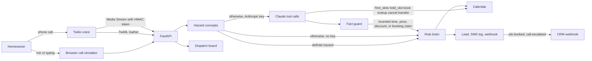

# AI Receptionist for Home Services

A dispatch desk that picks up when the shop cannot. Built as a client demo for **Asad Rehman**, AI agent developer: the receptionist qualifies a plumbing or HVAC call, books the job, and hands real emergencies to a person.

The sample shop is **Northline Plumbing & HVAC** in Austin. Riley answers. Miguel Santos is on call at +1 512-555-0199. The sample rules are for plumbing and HVAC. They are not a towing, dental, or med-spa agent.

## The problem

Home-service companies lose jobs in the gaps. The owner is under a sink, the office line rolls to voicemail, and the caller dials the next result. After-hours emergencies (a burst pipe, a gas smell, carbon monoxide symptoms) are worse: someone needs a person, not a routine visit booked for tomorrow.

A receptionist who only works business hours does not match how pipes fail.

## The solution

An AI receptionist that:

- Answers every call, on the phone or in a browser demo that needs no paid keys
- Detects whether this is a new job, a quote, an existing booking, spam, or an emergency
- Collects name, phone, address, and the issue, including spoken digits, apostrophes, apartment units, and mid-call corrections
- Checks a calendar against real shop hours and service area, and refuses a second booking on a taken window
- Books a 90-minute window and logs the confirmation that would be texted
- Transfers gas or odor, carbon monoxide, active water, electrical hazards, and no-heat or no-AC with a cold or hot home or a vulnerable person
- Cancels only after the caller gives the last four digits of the phone and the visit date, then a clear yes
- Pushes the lead to a mock CRM and a generic CRM webhook (GoHighLevel, HubSpot, or Zapier-compatible)

A text is sent only when Twilio SMS accepts it. Until `TWILIO_ACCOUNT_SID`, `TWILIO_AUTH_TOKEN`, and `TWILIO_FROM_NUMBER` are set, Riley says the visit is on the board and that no text was sent.

Swap `config/business.yaml` and the same desk serves a different plumbing or HVAC company: name, services, hours, ZIP codes, price bands, and the escalation number.

## Architecture



Two brains share one calendar.

**Rules.** The default, and the only brain when `ANTHROPIC_API_KEY` is empty. It owns the greeting, the questions, the offers, and the booking. There is no free-form rephrase step.

**Hazard concepts.** A turn escalates when a hazard is present and a narrow negation is not attached to that hazard. The concepts are gas or odor, carbon monoxide (a sounding alarm, symptoms, or a ppm reading), active water (pouring, flooding, a burst, sewage backup), electrical sparks or smoke, and no heat or no AC together with a temperature or a vulnerable person. English and Spanish synonyms are in the same detector. Historical wording is skipped only inside the clause that is historical. "Emergency shutoff" is a fixture. The word "emergency" otherwise escalates. A CO-alarm battery question is not a page; Riley gives battery safety advice. When the concepts are unsure, the call escalates.

**Claude tools.** When a key is set, Riley is `claude-sonnet-5-5` (Anthropic’s current Sonnet, checked against [the models overview](https://platform.claude.com/docs/en/models/overview) on 2026-10-22). The model may call `find_slots`, `hold_slot`, `book`, `lookup_booking`, `cancel`, and `transfer`. `follow_rules` is not a tool and is not a score. `book` and `hold_slot` require a name, a 10-digit phone, an in-area address, and a slot `find_slots` returned. `cancel` ignores a booking id and the model's `confirmed` flag. It runs only after the tool has matched the last four digits and the visit date and the caller's latest words are a clear yes. A hazard anywhere in the call forces `transfer` and blocks scheduling language.

The fact guard runs on the model's own words. Spoken numbers and times ("three in the afternoon", "forty-nine dollars") are normalized before the check. A clock time, a dollar amount, a percent, or a discount that did not come from a tool is replaced with the rule sentence. "Booked" or "confirmed" is allowed only after `book` succeeded on that turn.

Each model call is capped at 5 seconds. The whole turn gives up at 8 seconds or after two tool rounds, then the rules engine speaks. That stays inside Twilio's 15 second webhook limit.

**Live Claude has not been measured.** Pytest never calls Anthropic. `python -m evals.live_claude` is the opt-in probe. With no key it exits 2 and reports nothing. The numbers below are the rules engine and the scripted guard tests.

Without voice keys, Twilio uses its own speech recognition and a spoken reply (`<Gather>` / `<Say>`). Three silent results hang up. Emergencies return `<Dial>` with a 20-second timeout. If nobody answers and Twilio SMS accepts a page, Riley says the on-call tech is being paged. If SMS was not sent, Riley tells the caller to leave and call 911, says no text was sent, and asks them to call the shop again. Gather is the path that actually dials. Media Streams turn on only when `DEEPGRAM_API_KEY` and `ELEVENLABS_API_KEY` are both set. The stream URL carries a short-lived HMAC, not the admin token. `DEMO_MODE=0` rejects a socket with no token. The stream flushes a turn on trailing silence and, when `TWILIO_ACCOUNT_SID` is also set, updates the live call with `<Dial>` over the REST API. Until those keys exist, the stream is marked unconfigured and Gather remains the answering path.

## What was measured

`python -m evals.fresh` scores a frozen set written for this desk (143 sentences). It is the hazard detector, not Claude, and not a copied review file.

| | Rules engine |
| --- | ---: |
| Frozen lines | 143 |
| Emergency recall | 57 / 57 |
| CO-battery advice | 5 / 5 |
| Routine lines kept routine | 81 / 81 |
| Routine false escalations | 0 / 81 |

Live Claude was not called. There is no tool-mode column. `follow_rules` is not in `TOOL_SPECS`.

`backend/tests/heldout_callers.py` is the copied v1 review set plus paraphrases from the earlier round (72 scripted cases). The rules engine still passes it. That file is not a generalization score, and it is not scored as tool mode.

Scripted guard tests, still without a live model, reject a spoken afternoon time, a spoken dollar amount, a discount, a "booked" claim with no `book`, an invented slot, a cancel by booking id, and a gas-odor turn that tries to schedule. Separate tests cover an ambiguous yes, caller-ID alone, last-four plus visit date, apostrophe names, apartment units, and "Friday around noon."

Pytest collects 147 tests. None of them call Anthropic.

## Screenshots


The board’s CRM handoff, then the webhook log on the Leads page:


## Run it

Docker binds `127.0.0.1:43123` and defaults to `DEMO_MODE=0`. The board then asks for `ADMIN_TOKEN`. Demo mode is opt-in:

```bash
DEMO_MODE=1 docker compose up --build
```

Or without Docker. `start.sh` creates `.venv`, installs the app and pytest, builds the frontend, and binds `127.0.0.1:43123` with `DEMO_MODE=1` unless you override it.

```bash
./start.sh
```

Open [http://127.0.0.1:43123](http://127.0.0.1:43123). The board is seeded with sample calls. The **Call simulator** is the live demo: step through “Book a drain call,” or play “Gas smell” to see the transfer.

Tests, with no API key:

```bash
python3 -m venv .venv
.venv/bin/pip install -r requirements.txt -r requirements-dev.txt
.venv/bin/python -m pytest
.venv/bin/python -m evals.fresh
```

`python -m evals.live_claude` exits 2 until `ANTHROPIC_API_KEY` is set. It is not part of pytest.

`requirements.txt` is the runtime image. Pytest lives in `requirements-dev.txt`, and the Docker image installs both so `pytest` runs inside the container (`PYTHONPATH=/app/backend`).

## Put it on a real phone number

1. Deploy the container on a host with a public HTTPS URL. Publish the port yourself. The image listens on `127.0.0.1` inside the container, and Compose publishes that only on the host's loopback until you change the port binding.
2. Keep `DEMO_MODE=0` and set a long `ADMIN_TOKEN`. The board sends `Authorization: Bearer`. Demo reset stays closed. Twilio webhooks stay open so the carrier can post.
3. Set `PUBLIC_BASE_URL` to that origin, including any path prefix. Signature checks use the full URL with the query string. The Media Stream URL includes `?token=`, a short-lived HMAC derived from the admin token or the Twilio auth token.
4. In Twilio, buy a number and set the voice webhook to `POST https://desk.example.com/api/voice/twilio/incoming`.
5. Set `TWILIO_AUTH_TOKEN` so the app checks `X-Twilio-Signature`. Leave it empty only for local curl tests. Startup logs a warning when the token is empty.
6. Set `TWILIO_ACCOUNT_SID` as well if Media Streams should update the live call with `<Dial>` when a transfer is required. Set `TWILIO_FROM_NUMBER` too if a real SMS should be sent. Without it, the desk logs the body and says no text was sent.
7. Optional: `ANTHROPIC_API_KEY`. The model defaults to `claude-sonnet-5-5`. Override with `ANTHROPIC_MODEL` only if you have confirmed the id against Anthropic’s current model list. Run `python -m evals.live_claude` yourself. This repo does not ship a live score.
8. Optional: `DEEPGRAM_API_KEY` and `ELEVENLABS_API_KEY` for Media Streams. `voice.mode` in the YAML can force `gather` or `stream`. Stream mode stays on Gather until both keys exist.
9. Set `crm.webhook_url` in `config/business.yaml` to a CRM webhook. GoHighLevel, HubSpot, and Zapier all accept this JSON. Set `WEBHOOK_SECRET` to sign the body as `X-Receptionist-Signature`. Until a URL is set, payloads are logged on the Leads page with status `mock`.

A burst pipe or gas smell returns TwiML that dials `escalation.on_call_phone` after Riley tells the caller who is picking up, and quotes the $179 emergency dispatch fee. If the dial fails and SMS was sent, the caller hears that the on-call tech is being paged. If SMS was not sent, the caller hears the 911 line and that no text was sent.

## Configuration

`config/business.yaml` is the shop. Edit the name, agent name, hours (`sunday: null` means closed), ZIP codes, price rules, and the on-call contact. Restart the process. The simulator, the tests, and the phone webhook all read that file.

Environment variables are listed in `.env.example`. None are required for the local demo. `start.sh` defaults `DEMO_MODE` to on. Docker defaults it to off. `CORS_ORIGINS` defaults to the local board, not `*`. Request bodies over 100 KB are rejected. Calls and leads are kept 30 days (`RETENTION_DAYS`), then purged on startup and once a day.

## Project layout

- `backend/app/agent` — hazard concepts, fact guard, calendar, rules engine, and the tool dialog
- `backend/app/llm` — Claude client and the scripted stand-in used in tests
- `backend/app/voice` — Twilio signature check, Gather, dial fallback, Media Stream HMAC
- `backend/app/integrations.py` — Deepgram, ElevenLabs, Twilio SMS, and the signed CRM POST
- `backend/tests` — scenarios, the copied v1 review file, and guard tests
- `evals/fresh_set.py` — the frozen 143 lines
- `evals/live_claude.py` — opt-in live probe
- `frontend` — dispatch board and call simulator
- `config/business.yaml` — the sample plumbing and HVAC shop

## Suggested portfolio line

**Title:** AI Receptionist that answers, qualifies, and books plumbing and HVAC calls

**Description:** Missed calls are lost jobs. This receptionist picks up for a plumbing and HVAC shop, qualifies the caller, books a real window on the shop calendar, and transfers gas leaks and burst pipes to the on-call tech. A confirmation text goes out only when Twilio SMS accepts it. It demos in the browser with no API keys. With an Anthropic key, Claude is wired to book through tools; that live path has not been scored. The same webhook answers a Twilio number when you are ready.

**Tags:** AI Voice Agents, Twilio, Python, FastAPI, CRM Automation
