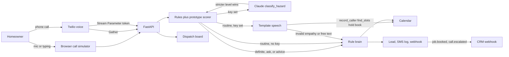

# AI Receptionist for Home Services

A dispatch desk that picks up when the shop cannot. Built as a client demo for **Asad Rehman**, AI agent developer: the receptionist qualifies a plumbing or HVAC call, books the job, and hands real emergencies to a person.

The sample shop is **Northline Plumbing & HVAC** in Austin. Riley answers. Miguel Santos is on call at +1 512-555-0199. The sample rules are for plumbing and HVAC. They are not a towing, dental, or med-spa agent.

## The problem

Home-service companies lose jobs in the gaps. The owner is under a sink, the office line rolls to voicemail, and the caller dials the next result. After-hours emergencies (a burst pipe, a gas smell, carbon monoxide symptoms) are worse: someone needs a person, not a routine visit booked for tomorrow.

A receptionist who only works business hours does not match how pipes fail.

## The solution

An AI receptionist that:

- Answers every call, on the phone or in a browser demo that needs no paid keys
- Detects whether this is a new job, a quote, an existing booking, spam, or an emergency
- Collects name, phone, address, and the issue, including spoken digits, apostrophes, apartment units, and mid-call corrections
- Checks a calendar against real shop hours and service area, and refuses a second booking on a taken window
- Books a 90-minute window and logs the confirmation that would be texted
- Transfers gas or odor, carbon monoxide, active water, electrical hazards, and no-heat or no-AC with a cold or hot home or a vulnerable person
- Cancels only after the caller gives the last four digits of the phone and the visit date, then a clear yes. Three failed checks on the call, or on that last-four, lock the lookup and transfer
- Pushes the lead to a mock CRM and a generic CRM webhook (GoHighLevel, HubSpot, or Zapier-compatible)

A text is sent only when Twilio SMS accepts it. Until `TWILIO_ACCOUNT_SID`, `TWILIO_AUTH_TOKEN`, and `TWILIO_FROM_NUMBER` are set, Riley says the visit is on the board and that no text was sent.

Swap `config/business.yaml` and the same desk serves a different plumbing or HVAC company: name, services, hours, ZIP codes, price bands, and the escalation number.

## Architecture



Two brains share one calendar. The caller never hears a fact the server did not render.

**Rules.** The default, and the only brain when `ANTHROPIC_API_KEY` is empty. It owns the greeting, the questions, the offers, and the booking.

**Hazards.** Concept rules run first. Beside them, a local character-trigram scorer compares the utterance to short hazard prototypes in several languages. That scorer is not the mDeBERTa NLI checkpoint; the weights are not in this repo. Past wording is damped unless a hazard is happening now. No heat or no cooling is urgent together with an older adult, an infant, oxygen, or an extreme indoor temperature. A bare "the AC is not cooling" stays a routine booking. Fee questions, stove conversions, and a car out of gas do not page. When the result is uncertain, Riley asks "Is anyone in danger right now?" instead of booking. With a model configured, Claude also classifies, and the stricter level wins. Gas or carbon monoxide advice stops at leaving the house and calling 911 or the gas company. There is no DIY relight or battery-swap instruction.

**Claude tools.** When a key is set, Riley is `claude-sonnet-5-5` (Anthropic’s current Sonnet, checked against [the models overview](https://platform.claude.com/docs/en/models/overview) on 2026-10-22). The model returns a tool call, not a caller-facing paragraph. `speak` takes an intent from a fixed set (`greet`, `ask_field`, `offer_slots`, `confirm_booking`, `quote_standard_prices`, `transfer`, `cancel_flow`, `goodbye`, `small_talk`), an optional field, and an optional empathy line. The empathy line is rejected if it contains a digit, a time, a price, a promise, or an instruction. The server fills every fact from templates and tool results. Anything that fails that check falls back to the rules engine. `record_caller` validates name, phone, address, and unit and reads them back, which is what lets `hold_slot` and `book` succeed. `transfer` runs only after the hazard classifier or the caller asked for a person. `follow_rules` is not a tool and is not a score.

Each model call is capped at 5 seconds. The whole turn gives up at 8 seconds or after two tool rounds, then the rules engine speaks. That stays inside Twilio's 15 second webhook limit.

**Live Claude has not been measured.** Pytest never calls Anthropic. `python -m evals.live_claude` is the opt-in probe. With no key it exits 2 and reports nothing. The numbers below are the local detector and the scripted tool tests.

Without voice keys, Twilio uses its own speech recognition and a spoken reply (`<Gather>` / `<Say>`). Three silent results hang up and ask the caller to call back. Emergencies return `<Dial>` with a 20-second timeout. If a second on-call number is set in the YAML, a no-answer tries that number once. If nobody answers and Twilio SMS accepts a page, Riley says the on-call tech is being paged and tells the caller to leave and call 911 or the gas company. If SMS was not sent, Riley gives that same guidance and says no text was sent. Riley does not tell the caller to dial this shop number again. Spanish callers hear Spanish prompts. Gather is the path that actually dials. Media Streams turn on only when `DEEPGRAM_API_KEY` and `ELEVENLABS_API_KEY` are both set. The stream URL has no token. TwiML passes a one-time HMAC in `<Parameter name="token">`, and the socket reads it from the start message `customParameters`. A replay is rejected. `DEMO_MODE=0` rejects a start message with no token. The stream flushes a turn on trailing silence and, when `TWILIO_ACCOUNT_SID` is also set, updates the live call with `<Dial>` over the REST API. Until those keys exist, the stream is marked unconfigured and Gather remains the answering path.

## What was measured

`python -m evals.fresh` scores a frozen set written for this desk (105 sentences, composed here). It is the local detector, not Claude, and not a reviewer's caller list. A perfect score here is not a score on a private set this repo has not seen.

| | Local detector |
| --- | ---: |
| Frozen lines | 105 |
| Emergency recall | 37 / 37 |
| CO-battery advice | 6 / 6 |
| Routine lines kept routine | 62 / 62 |
| Routine false escalations | 0 / 62 |

Live Claude was not called. There is no live tool-mode column. `follow_rules` is not in `TOOL_SPECS`.

`backend/tests/heldout_callers.py` is the copied v1 review set plus paraphrases from an earlier round (72 scripted cases). The rules engine still passes it. That file is not a generalization score, and it is not scored as tool mode.

Scripted guard tests, still without a live model, drop free-form text (a made-up afternoon, a made-up price, a discount, a "booked" claim). A cooperative script that calls `record_caller`, then `find_slots`, `hold_slot`, and `book` does book. An invented slot does not. A model-initiated `transfer` on a faucet quote does not page. Cancel verification locks out after 3 failed attempts on the call and on that last-four, then transfers. Separate tests cover accented names, Suite versus Apt, a spoken last-four correction, a house-number correction read back, "first Monday in November," Halloween morning, "next week except Monday," and "half past" / "4ish."

Pytest collects 154 tests. None of them call Anthropic.

## Screenshots


The board’s CRM handoff, then the webhook log on the Leads page:


## Run it

Compose publishes `127.0.0.1:43123` and defaults to `DEMO_MODE=0`. Inside the container, uvicorn binds `0.0.0.0` so that published port can reach it. `ADMIN_TOKEN`, Twilio settings, `PUBLIC_BASE_URL`, and `ANTHROPIC_API_KEY` are passed through when they are set in the environment. The image copies `evals/` and installs pytest. This workspace has no Docker CLI, so the image was not built or tested here. Demo mode is opt-in:

```bash
DEMO_MODE=1 docker compose up --build
```

Or without Docker. `start.sh` creates `.venv`, installs the app and pytest, builds the frontend, and binds `127.0.0.1:43123` with `DEMO_MODE=1` unless you override it.

```bash
./start.sh
```

Open [http://127.0.0.1:43123](http://127.0.0.1:43123). The board is seeded with sample calls. The **Call simulator** is the live demo: step through “Book a drain call,” or play “Gas smell” to see the transfer.

Tests, with no API key:

```bash
python3 -m venv .venv
.venv/bin/pip install -r requirements.txt -r requirements-dev.txt
.venv/bin/python -m pytest
.venv/bin/python -m evals.fresh
```

`python -m evals.live_claude` exits 2 until `ANTHROPIC_API_KEY` is set. It is not part of pytest.

`requirements.txt` is the runtime image. Pytest lives in `requirements-dev.txt`. The image installs both and sets `PYTHONPATH=/app/backend:/app` so `pytest` can import the app and `evals`. To run the suite in the image: `docker compose build && docker compose run --rm receptionist pytest -q`.

## Put it on a real phone number

1. Deploy the container on a host with a public HTTPS URL. The process listens on `0.0.0.0:43123`. Compose publishes `127.0.0.1:43123` on the host; change that binding when the host should accept traffic from Twilio.
2. Keep `DEMO_MODE=0` and set a long `ADMIN_TOKEN`. The board sends `Authorization: Bearer`. Demo reset stays closed. Twilio webhooks stay open so the carrier can post. The sign-in screen loads calls and leads. The simulator stays off unless demo mode is on.
3. Set `PUBLIC_BASE_URL` to that origin, including any path prefix. Signature checks use the full URL with the query string. The Media Stream URL does not carry the token. TwiML puts a single-use HMAC in `<Parameter name="token">`.
4. In Twilio, buy a number and set the voice webhook to `POST https://desk.example.com/api/voice/twilio/incoming`.
5. Set `TWILIO_AUTH_TOKEN` so the app checks `X-Twilio-Signature`. Leave it empty only for local curl tests. Startup logs a warning when the token is empty.
6. Set `TWILIO_ACCOUNT_SID` as well if Media Streams should update the live call with `<Dial>` when a transfer is required. Set `TWILIO_FROM_NUMBER` too if a real SMS should be sent. Without it, the desk logs the body and says no text was sent.
7. Optional: `ANTHROPIC_API_KEY`. The model defaults to `claude-sonnet-5-5`. Override with `ANTHROPIC_MODEL` only if you have confirmed the id against Anthropic’s current model list. Run `python -m evals.live_claude` yourself. This repo does not ship a live score.
8. Optional: `DEEPGRAM_API_KEY` and `ELEVENLABS_API_KEY` for Media Streams. `voice.mode` in the YAML can force `gather` or `stream`. Stream mode stays on Gather until both keys exist.
9. Set `crm.webhook_url` in `config/business.yaml` to a CRM webhook. GoHighLevel, HubSpot, and Zapier all accept this JSON. Set `WEBHOOK_SECRET` to sign the body as `X-Receptionist-Signature`. Until a URL is set, payloads are logged on the Leads page with status `mock`.

A burst pipe or gas smell returns TwiML that dials `escalation.on_call_phone` after Riley tells the caller who is picking up, and quotes the $179 emergency dispatch fee. Optional `escalation.on_call_phone_2` is dialed once if the first number does not answer. If the dial fails and SMS was sent, the caller hears that the on-call tech is being paged, plus 911 or the gas company. If SMS was not sent, the caller hears that guidance and that no text was sent.

## Configuration

`config/business.yaml` is the shop. Edit the name, agent name, hours (`sunday: null` means closed), ZIP codes, price rules, and the on-call contact. Restart the process. The simulator, the tests, and the phone webhook all read that file.

Environment variables are listed in `.env.example`. None are required for the local demo. `start.sh` defaults `DEMO_MODE` to on. Docker defaults it to off. `CORS_ORIGINS` defaults to the local board, not `*`. Request bodies over 100 KB are rejected. Calls and leads are kept 30 days (`RETENTION_DAYS`), then purged on startup and once a day.

## Project layout

- `backend/app/agent` — hazard concepts, prototype scorer, template speech, calendar, rules engine, and the tool dialog
- `backend/app/llm` — Claude client and the scripted stand-in used in tests
- `backend/app/voice` — Twilio signature check, Gather, dial fallback, single-use stream token
- `backend/app/integrations.py` — Deepgram, ElevenLabs, Twilio SMS, and the signed CRM POST
- `backend/tests` — scenarios, the copied v1 review file, and guard tests
- `evals/fresh_set.py` — the frozen 105 lines written for this desk
- `evals/live_claude.py` — opt-in live probe
- `frontend` — dispatch board and call simulator
- `config/business.yaml` — the sample plumbing and HVAC shop

## Suggested portfolio line

**Title:** AI Receptionist that answers, qualifies, and books plumbing and HVAC calls

**Description:** Missed calls are lost jobs. This receptionist picks up for a plumbing and HVAC shop, qualifies the caller, books a real window on the shop calendar, and transfers gas leaks and burst pipes to the on-call tech. A confirmation text goes out only when Twilio SMS accepts it. It demos in the browser with no API keys. With an Anthropic key, Claude chooses tools and `record_caller` can book; that live path has not been scored. Caller-facing facts come from server templates. The same webhook answers a Twilio number when you are ready.

**Tags:** AI Voice Agents, Twilio, Python, FastAPI, CRM Automation
