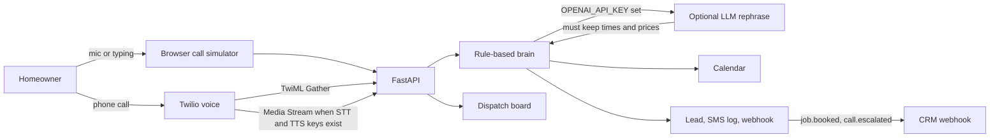

# AI Receptionist for Home Services

A dispatch desk that picks up when the shop cannot. Built as a client demo for **Asad Rehman**, AI agent developer: the same receptionist that qualifies a plumber, HVAC, towing, dental, or med-spa call, books the job, and hands emergencies to a human.

The sample shop is **Northline Plumbing & HVAC** in Austin. Riley answers. Miguel Santos is on call.

## The problem

Home-service companies lose jobs in the gaps. The owner is under a sink, the office line rolls to voicemail, and the caller dials the next result. After-hours emergencies (a burst pipe, a gas smell) are worse: someone needs a person, not a “we’ll call you tomorrow.”

A receptionist who only works business hours does not match how pipes fail.

## The solution

An AI receptionist that:

- Answers every call, on the phone or in a browser demo that needs no paid keys
- Detects whether this is a new job, a quote, an existing booking, spam, or an emergency
- Collects name, phone, address, and the issue
- Checks a calendar against real shop hours and service area
- Books a 90-minute window and logs a confirmation text
- Transfers burst pipes, gas, carbon monoxide, sewage backups, flooding, and electrical sparking to the on-call technician
- Pushes the lead to a mock CRM and a generic CRM webhook (GoHighLevel, HubSpot, or Zapier-compatible)

Swap `config/business.yaml` and the same desk serves a different company: name, services, hours, ZIP codes, price bands, and the escalation number.

## Architecture



Without keys, Twilio uses its own speech recognition and a spoken reply (`<Gather>` / `<Say>`). Emergencies return `<Dial>` to the on-call number. When `DEEPGRAM_API_KEY` and `ELEVENLABS_API_KEY` are both set, inbound calls switch to a Media Stream: Deepgram transcribes mulaw audio, ElevenLabs speaks ulaw 8 kHz back down the socket. An OpenAI-compatible key only rephrases lines. It cannot invent a slot or skip a transfer. If the rewrite drops a time or a price, the rule line is kept.

## Features

- Greeting, intent, slot filling, availability, booking, confirmation text, and emergency transfer
- Per-business YAML: hours, service area, services, diagnostic fee, price bands, on-call contact, CRM webhook
- Dispatch board with outcomes (booked, escalated, missed, spam, and a few edge results), per-turn latency, and p50/p95
- Call log and full transcript
- Week calendar of booked jobs
- Leads, logged SMS, and webhook payloads with a replay button
- Browser simulator using the Web Speech API, plus type-to-talk and one-click scenarios
- Pytest scenario suite: 37 scripted callers, plus Twilio, CRM, latency, and media-stream tests
- Docker Compose, or `./start.sh` on a machine with Python and Node

## Screenshots


The board’s CRM handoff, then the webhook log on the Leads page:


## Run it

Docker, from the repo root:

```bash
docker compose up --build
```

Or without Docker:

```bash
./start.sh
```

Open [http://127.0.0.1:43123](http://127.0.0.1:43123). The board is seeded with a week of sample calls. The **Call simulator** is the live demo: step through “Book a drain call,” or play “Gas smell” to see the transfer.

Tests:

```bash
python3 -m pip install -r requirements.txt
python3 -m pytest
```

The scenario suite drives the receptionist as text and asserts outcome, intent, spoken phrases, calendar slot, SMS, webhook, and transfer events. Every turn must finish in under 250 ms. On this desk the rule brain’s median reply is well under a millisecond; the board shows the live p50 and p95.

## Put it on a real phone number

1. Deploy the container on a host with a public HTTPS URL.
2. Set `PUBLIC_BASE_URL` to that origin, for example `https://desk.example.com`.
3. In Twilio, buy a number and set the voice webhook to `POST https://desk.example.com/api/voice/twilio/incoming`.
4. Set `TWILIO_AUTH_TOKEN` so the app checks `X-Twilio-Signature`. Leave it empty only for local curl tests.
5. Optional: `OPENAI_API_KEY` (and `OPENAI_BASE_URL` / `OPENAI_MODEL` if you are not on OpenAI) to rephrase replies.
6. Optional: `DEEPGRAM_API_KEY` and `ELEVENLABS_API_KEY` to switch that number from Gather to Media Streams. `voice.mode` in the YAML can force `gather` or `stream`. Stream mode stays on Gather until both keys exist, so a half-configured shop still answers.
7. Set `crm.webhook_url` in `config/business.yaml` to a CRM webhook. GoHighLevel, HubSpot, and Zapier all accept this JSON. Until a URL is set, payloads are logged on the Leads page with status `mock`.

A burst pipe or gas smell returns TwiML that dials `escalation.on_call_phone` after Riley tells the caller who is picking up.

## Configuration

`config/business.yaml` is the shop. Edit the name, agent name, hours (`sunday: null` means closed), ZIP codes, price rules, and the on-call contact. Restart the process. The simulator, the tests, and the phone webhook all read that file.

Environment variables are listed in `.env.example`. None are required for the demo.

## Project layout

- `backend/app/agent` — intents, calendar math, and the rule engine
- `backend/app/voice` — Twilio signature check, TwiML, Media Streams
- `backend/app/integrations.py` — OpenAI, Deepgram, ElevenLabs, CRM POST
- `backend/tests` — caller scenarios and API tests
- `frontend` — dispatch board and call simulator
- `config/business.yaml` — the sample plumbing and HVAC shop

## Suggested portfolio line

**Title:** AI Receptionist that answers, qualifies, and books home-service calls

**Description:** Missed calls are lost jobs. This receptionist picks up for plumbers, HVAC, and other appointment trades, qualifies the caller, books a real window on the shop calendar, texts a confirmation, and transfers gas leaks and burst pipes to the on-call tech. It demos in the browser with no API keys, and the same webhook answers a Twilio number when you are ready.

**Tags:** AI Voice Agents, Twilio, Python, FastAPI, CRM Automation
