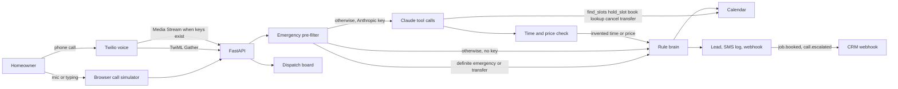

# AI Receptionist for Home Services

A dispatch desk that picks up when the shop cannot. Built as a client demo for **Asad Rehman**, AI agent developer: the receptionist qualifies a plumbing or HVAC call, books the job, and hands real emergencies to a person.

The sample shop is **Northline Plumbing & HVAC** in Austin. Riley answers. Miguel Santos is on call at +1 512-555-0199. The sample rules are for plumbing and HVAC. They are not a towing, dental, or med-spa agent.

## The problem

Home-service companies lose jobs in the gaps. The owner is under a sink, the office line rolls to voicemail, and the caller dials the next result. After-hours emergencies (a burst pipe, a gas smell, carbon monoxide symptoms) are worse: someone needs a person, not a routine visit booked for tomorrow.

A receptionist who only works business hours does not match how pipes fail.

## The solution

An AI receptionist that:

- Answers every call, on the phone or in a browser demo that needs no paid keys
- Detects whether this is a new job, a quote, an existing booking, spam, or an emergency
- Collects name, phone, address, and the issue, including spoken digits and mid-call corrections
- Checks a calendar against real shop hours and service area, and refuses a second booking on a taken window
- Books a 90-minute window and logs a confirmation text
- Transfers burst pipes, gas (including “huele a gas”), carbon monoxide, sewage backups, flooding, no-heat with an infant or elderly person, and electrical sparking to the on-call technician
- Reads a cancellation back and cancels only after the caller confirms, and only when the phone matches
- Pushes the lead to a mock CRM and a generic CRM webhook (GoHighLevel, HubSpot, or Zapier-compatible)

Swap `config/business.yaml` and the same desk serves a different plumbing or HVAC company: name, services, hours, ZIP codes, price bands, and the escalation number.

## Architecture



Two brains share one calendar.

**Rules.** The default, and the only brain when `ANTHROPIC_API_KEY` is empty. It owns the greeting, the questions, the offers, and the booking. There is no free-form rephrase step. A model is not allowed to rewrite a sentence after the rules have spoken.

**Claude tools.** When a key is set, Riley is `claude-sonnet-5-5` (Anthropic’s current Sonnet, checked against [the models overview](https://platform.claude.com/docs/en/models/overview) on 2026-10-22). The model may call `find_slots`, `hold_slot`, `book`, `lookup_booking`, `cancel` (only with `confirmed: true`), and `transfer`. Tool results are the only source of times, prices, bookings, and cancellations. A deterministic emergency pre-filter runs first and can force a transfer before the model speaks. After the model talks, every clock time and dollar amount in its own words must appear in a tool result from that turn. If it does not, the caller hears the rule sentence instead.

**CI stand-in.** Tests never call Anthropic. They inject `ScriptedToolModel`, which returns the tool `follow_rules` and lets the rules engine take the turn. The held-out “tool mode” score below is that stand-in, walking through the same pre-filter and fact check. It is not a live Claude score.

Without voice keys, Twilio uses its own speech recognition and a spoken reply (`<Gather>` / `<Say>`). Three silent results hang up. Emergencies return `<Dial>` with a 20-second timeout; if nobody answers, the desk logs an SMS page to the on-call tech. Gather is the path that actually dials. Media Streams turn on only when `DEEPGRAM_API_KEY` and `ELEVENLABS_API_KEY` are both set. The stream flushes a turn on trailing silence and, when `TWILIO_ACCOUNT_SID` is also set, updates the live call with `<Dial>` over the REST API. Until those keys exist, the stream is marked unconfigured and Gather remains the answering path.

## Features

- Greeting, intent, slot filling, availability, booking, confirmation text, and emergency transfer
- One truck per window: a unique index on active start times, a per-call lock, and a cached reply when the same utterance is repeated
- Cancellation requires a matching phone and an explicit yes after the readback. A first name alone does not cancel
- Per-business YAML: hours, service area, services, diagnostic fee ($89), after-hours fee ($149), emergency dispatch ($179), price bands, on-call contact, CRM webhook
- Dispatch board with outcomes, wall-clock end-to-end latency, and p50/p95
- Call log, transcript, week calendar, leads, logged SMS, and webhook payloads with replay
- Browser simulator using the Web Speech API, plus type-to-talk and one-click scenarios
- Optional Bearer auth: `DEMO_MODE=0` plus `ADMIN_TOKEN` locks `/api` except health and the Twilio webhooks. Demo reset returns 404 when demo mode is off. The local demo defaults to `DEMO_MODE=1`
- Calls and leads are kept 30 days (`RETENTION_DAYS`), then purged on startup and via `POST /api/admin/purge`
- Pytest: 37 original callers, 72 held-out callers in both modes, plus Twilio, concurrency, auth, and media-stream tests (205 tests)
- Docker Compose, or `./start.sh`, which creates a virtualenv

## Held-out callers

The review set is the 47 unseen callers from the QA scripts, plus 25 paraphrases (19 more emergencies, 4 more false alarms, and 2 capture/STT variants). Both modes were scored by pytest on 2026-10-22. Every case passed.

| | Rules (no key) | Tool mode (CI stand-in) |
| --- | ---: | ---: |
| Held-out callers | 72 / 72 | 72 / 72 |
| Review set (the original 47) | 47 / 47 | 47 / 47 |
| Emergency recall, review set | 9 / 9 | 9 / 9 |
| Emergency recall, with paraphrases | 28 / 28 | 28 / 28 |
| False emergencies kept as routine bookings | 8 / 8 | 8 / 8 |

The nine review emergencies include water pouring through a ceiling, carbon monoxide symptoms, a chirping CO alarm, and “huele a gas.” The eight false emergencies (a detector install, a drip, last winter’s burst pipe, a gas water heater replacement, a high gas bill) book a normal visit.

Live Claude was not called. The tool-mode column is `ScriptedToolModel` returning `follow_rules`, so those two columns match by construction. Separate tests reject a scripted model that tries to change the weekday, add a price, drop the address, or tell a burst-pipe caller it is not an emergency. Those four adversarial replies are not spoken.

The original 37 scripted scenarios still pass, including the updated cancel and reschedule flows that ask for the phone on the appointment.

## Screenshots


The board’s CRM handoff, then the webhook log on the Leads page:


## Run it

Docker, from the repo root:

```bash
docker compose up --build
```

Or without Docker. `start.sh` creates `.venv`, installs the app and pytest, builds the frontend, and binds `127.0.0.1:43123`.

```bash
./start.sh
```

Open [http://127.0.0.1:43123](http://127.0.0.1:43123). The board is seeded with sample calls. The **Call simulator** is the live demo: step through “Book a drain call,” or play “Gas smell” to see the transfer.

Tests, with no API key:

```bash
python3 -m venv .venv
.venv/bin/pip install -r requirements.txt -r requirements-dev.txt
.venv/bin/python -m pytest
```

`requirements.txt` is the runtime image. Pytest lives in `requirements-dev.txt`, and the Docker image installs both so `pytest` runs inside the container (`PYTHONPATH=/app/backend`).

## Put it on a real phone number

1. Deploy the container on a host with a public HTTPS URL.
2. Set `DEMO_MODE=0` and a long `ADMIN_TOKEN`. The demo reset routes stay closed. Twilio webhooks stay open so the carrier can post.
3. Set `PUBLIC_BASE_URL` to that origin, including any path prefix. Signature checks use the full URL with the query string.
4. In Twilio, buy a number and set the voice webhook to `POST https://desk.example.com/api/voice/twilio/incoming`.
5. Set `TWILIO_AUTH_TOKEN` so the app checks `X-Twilio-Signature`. Leave it empty only for local curl tests. Startup logs a warning when the token is empty.
6. Set `TWILIO_ACCOUNT_SID` as well if Media Streams should update the live call with `<Dial>` when a transfer is required.
7. Optional: `ANTHROPIC_API_KEY`. The model defaults to `claude-sonnet-5-5`. Override with `ANTHROPIC_MODEL` only if you have confirmed the id against Anthropic’s current model list.
8. Optional: `DEEPGRAM_API_KEY` and `ELEVENLABS_API_KEY` for Media Streams. `voice.mode` in the YAML can force `gather` or `stream`. Stream mode stays on Gather until both keys exist.
9. Set `crm.webhook_url` in `config/business.yaml` to a CRM webhook. GoHighLevel, HubSpot, and Zapier all accept this JSON. Set `WEBHOOK_SECRET` to sign the body as `X-Receptionist-Signature`. Until a URL is set, payloads are logged on the Leads page with status `mock`.

A burst pipe or gas smell returns TwiML that dials `escalation.on_call_phone` after Riley tells the caller who is picking up, and quotes the $179 emergency dispatch fee. If the dial fails, the caller is told the on-call tech was texted.

## Configuration

`config/business.yaml` is the shop. Edit the name, agent name, hours (`sunday: null` means closed), ZIP codes, price rules, and the on-call contact. Restart the process. The simulator, the tests, and the phone webhook all read that file.

Environment variables are listed in `.env.example`. None are required for the local demo. `DEMO_MODE` defaults to on. `CORS_ORIGINS` defaults to the local board, not `*`. Request bodies over 100 KB are rejected.

## Project layout

- `backend/app/agent` — intents, emergency pre-filter, calendar, rules engine, and the tool dialog
- `backend/app/llm` — Claude client and the scripted stand-in used in tests
- `backend/app/voice` — Twilio signature check, Gather, dial fallback, Media Streams
- `backend/app/integrations.py` — Deepgram, ElevenLabs, and the signed CRM POST
- `backend/tests` — original scenarios, held-out callers, and regression tests for each fix
- `frontend` — dispatch board and call simulator
- `config/business.yaml` — the sample plumbing and HVAC shop

## Suggested portfolio line

**Title:** AI Receptionist that answers, qualifies, and books plumbing and HVAC calls

**Description:** Missed calls are lost jobs. This receptionist picks up for a plumbing and HVAC shop, qualifies the caller, books a real window on the shop calendar, texts a confirmation, and transfers gas leaks and burst pipes to the on-call tech. It demos in the browser with no API keys. With an Anthropic key, Claude books through tools and cannot invent a time or a price. The same webhook answers a Twilio number when you are ready.

**Tags:** AI Voice Agents, Twilio, Python, FastAPI, CRM Automation
